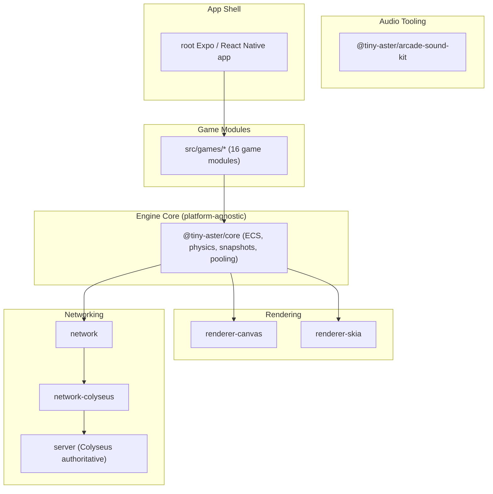

# 🕹️ Tiny Aster — A Deterministic ECS Arcade Engine

> A cross-platform, deterministic Entity-Component-System engine for a modular retro arcade suite, with dual rendering (Canvas & Skia) and authoritative multiplayer netcode.

[]()
[]()
[]()

---

## Why this project exists

Most React Native game demos hardcode gameplay logic directly into UI components. **Tiny Aster** takes the opposite approach: game logic lives in a **platform-agnostic ECS core** (`@tiny-aster/core`), completely decoupled from React Native, Expo, and the renderer. Presentation (Canvas/Skia) and multiplayer (Colyseus) are plugged in as swappable adapters, enforced by an automated boundary check (`scripts/check-core-boundaries.sh`) that forbids the core from importing React Native, Expo, Skia, Colyseus, or game-specific code.

This makes the engine:

- **Deterministic** — gameplay-affecting randomness is isolated to `world.gameplayRandom`, enabling reproducible simulations, replay, and rollback netcode.
- **Portable** — game modules under `src/games/` build on a platform-agnostic core and can use Canvas or Skia rendering adapters.
- **Testable in isolation** — the core has no dependency on a rendering surface or platform, so systems, physics, and pooling can be unit-tested headlessly.

---

## 🏗️ Architecture



### Monorepo layout

The monorepo currently contains **8 workspace packages** under `packages/`, plus the `server/` workspace. The repository root is the Expo application.

| Package / workspace | Responsibility |
| ------------------- | -------------- |
| `packages/core` | Platform-agnostic ECS runtime, physics, systems, snapshots/rollback, pooling, input and event infrastructure |
| `packages/gameplay-kit` | Reusable arcade gameplay systems such as combat, spawning, power-ups, loot and achievements |
| `packages/renderer-canvas` | Web/Canvas rendering adapter, shape drawers and background effects |
| `packages/renderer-skia` | React Native Skia rendering adapter |
| `packages/network` | Networking abstractions shared across transports |
| `packages/network-colyseus` | Colyseus client integration for authoritative multiplayer |
| `packages/react-native` | React Native hooks, providers and application bindings |
| `packages/arcade-sound-kit` | Procedural sound-design toolkit; recipe-based SFX generation and offline WAV/manifest export |
| `src/games/*` | Game modules and shared game infrastructure |
| `server/` | Headless Colyseus authoritative game server |
| Repository root | Expo / React Native application assembling the workspace packages |

### Project identity and naming

The product and engine brand is **Tiny Aster**; `ArcadeGames` is the GitHub repository name. The root Expo application still uses the private legacy workspace name `asteroides` and the existing Expo/native identifiers. Those identifiers remain unchanged until a dedicated compatibility migration. See the [project identity and naming contract](docs/PROJECT_IDENTITY_AND_NAMING.md).

---

## ✨ Engine Features

- **Deterministic ECS runtime** with typed components, systems, and a `BaseGame` lifecycle abstraction shared by every game.
- **Snapshot/restore & rollback** support for authoritative-server netcode reconciliation.
- **Component & prefab pooling** (`ComponentSetPool`, `PrefabPool`) with dev-mode detection of double-release and partial-destruction bugs — the kind of engine hygiene most hobby ECS implementations skip.
- **TTL system** for automatic entity lifecycle management.
- **Dual renderer strategy**: pluggable `CanvasRenderer` / Skia renderer, each implementing a common shape-drawer registration contract (`registerShape`, `registerBackgroundEffect`).
- **Integrated Audio System**: Low-latency browser audio playback via `WebAudioPlayer` (HTML5 `AudioContext` and `HTMLAudioElement` for SFX caching and BGM streaming), with a decoupled `PlaySFX` global event listener on `BaseGame`.

### 🔊 Audio System

The engine features a platform-agnostic audio system designed for a decouple-first architecture:

1. **`IAudioPlayer` Contract**: `BaseGame` abstracts all audio operations behind `IAudioPlayer` (with `NullAudioPlayer` serving as a headless/testing/server fallback).
2. **`WebAudioPlayer`**: High-performance browser implementation leveraging the Web Audio API (`AudioContext`) for low-latency SFX playback with spatial panning/attenuation and `HTMLAudioElement` for looping background music.
   - _Graceful Fallback_: Includes a mechanism that caches a silent dummy buffer if loading/decoding fails, avoiding potential errors on subsequent play calls.
3. **Decoupled Event-Driven Sound Triggering**: ECS systems do not need to call the audio player directly. Instead, they simply emit a `"PlaySFX"` event to the central `EventBus`:
   ```typescript
   eventBus.emit("PlaySFX", { name: "hit" });
   ```
   A global listener registered in `BaseGame` intercepts these events and plays them on the configured audio player automatically.
4. **Dependency Injection**: Game instances can accept any custom player via the constructor's `BaseGameConfig`, falling back to `WebAudioPlayer` on client platforms:
   ```typescript
   const game = new PongGame({ audio: new WebAudioPlayer() });
   ```

**Runtime playback vs. sound authoring:** `@tiny-aster/core` owns the runtime playback contract (`IAudioPlayer`, `NullAudioPlayer`) and the browser implementation (`WebAudioPlayer`). The separate `@tiny-aster/arcade-sound-kit` package authors procedural sounds and exports WAV files/manifests; it complements the runtime player and does not replace it.

## 🎮 Games included

The repository currently contains **16 game modules** (directories other than `shared/`) under `src/games/`. A directory's presence documents a module; it does **not** by itself certify that the game is complete, production-ready or fully playable.

| Game module | Source directory |
| ----------- | ---------------- |
| `arkanoid` | `src/games/arkanoid` |
| `asteroids` | `src/games/asteroids` |
| `centipede` | `src/games/centipede` |
| `echorunner` | `src/games/echorunner` |
| `flappybird` | `src/games/flappybird` |
| `frogger` | `src/games/frogger` |
| `galaxian` | `src/games/galaxian` |
| `geometrywars` | `src/games/geometrywars` |
| `hitandrun` | `src/games/hitandrun` |
| `outrun` | `src/games/outrun` |
| `platformer` | `src/games/platformer` |
| `pong` | `src/games/pong` |
| `racing` | `src/games/racing` |
| `space-invaders` | `src/games/space-invaders` |
| `tower-defense` | `src/games/tower-defense` |
| `vertical-shmup` | `src/games/vertical-shmup` |

`src/games/shared/` contains shared game infrastructure and is not counted as a game module.

---

## 🚀 Quick Start

### Prerequisites

- Node.js ≥ 20
- pnpm 10.x
- Expo Go (for mobile device testing)

### Installation

```bash
# Install all workspace dependencies
pnpm install

# Start the client (Expo, builds core first via Turborepo)
pnpm start

# Start the authoritative server (Colyseus)
cd server
pnpm install
pnpm run dev
```

### Platform-specific dev builds

```bash
pnpm android   # Android via Expo
pnpm ios       # iOS via Expo
pnpm web       # Web via react-native-web
```

---

## ⚡ Turborepo & Monorepo Optimization

The repository utilizes **Turborepo** with **pnpm workspaces** for fast, deterministic, cache-aware builds and tests.

### Configuration & Caching Metrics

- **Pipeline Tasks (`turbo.json`)**:
  - `build`: Captures build artifacts across workspaces (`dist/**`, `build/**`) based on `src/**`, `package.json`, and `tsconfig.json`.
  - `typecheck`: Cache-aware typechecking dependent on `^build`.
  - `lint`: Cached linting step scoped to workspace sources.
  - `test`: Executes tests across dependent packages.
- **Measured Benchmark Impact**:
  - **Cold Build**: ~33s (compiling `@tiny-aster/core`, renderers, network transports, and server).
  - **Warm Build**: duration and cache-hit rate depend on the commit, runner, and cache state. Record benchmark figures from a reproducible run; this README does not claim a fixed duration or workspace count.

### Cache Maintenance & Full Clean

To purge build artifacts, Turborepo caches, and platform watchman/metro caches:

```bash
pnpm clean:full   # Purges .turbo/, node_modules/.cache, dist/, temp/, metro/watchman caches
```

### Game module organization

Game-specific code currently lives in `src/games/<game-id>/`; shared game infrastructure lives in `src/games/shared/`. The workspace packages provide reusable engine, rendering, networking, React Native and audio-tooling capabilities. The current repository does not define one npm package per game, so the `packages/games-*` names below are not presented as existing packages or an approved migration plan.

## 🧪 Quality gates

### Local aggregate gate

`pnpm ci` currently runs the following sequence:

```bash
pnpm run build:core
pnpm --filter=@tiny-aster/gameplay-kit build
pnpm run check:agent-guardrails
pnpm run docs:check
pnpm run typecheck:app
```

`check:agent-guardrails` expands to these checks:

```bash
pnpm run check:core-boundaries
pnpm run check:gameplay-kit-boundaries
pnpm run check:network-boundaries
pnpm run check:input-contract
pnpm run check:ratchet
pnpm run check:duplication
pnpm run check:color-literals
pnpm run check:game-patterns
pnpm run story:lint
```

`docs:check` validates the README inventories, workspace package scopes, project identity, agent-document links, wiki game count and documented quality-gate commands against repository files. It is separate from API documentation generation: use `pnpm run docs:extract` to extract the API model and `pnpm docs:build` to generate the Markdown API reference.

### Additional local checks

```bash
pnpm test
pnpm lint
pnpm run test:ci
pnpm run test:games:ci
pnpm run test:e2e
pnpm run sprites:build -- --check
pnpm run sprites:validate
pnpm run typecheck:core
pnpm run typecheck:app
pnpm run architecture:check
```

The three debt ratchets measure type assertions, code duplication and color literals. Their committed baselines, exact enforcement rules and 90-day reduction targets are documented in [Technical-debt ratchets](docs/TECHNICAL_DEBT_RATCHETS.md). Update baselines only in a pull request that explains and verifies the corresponding remediation.

### GitHub Actions

The GitHub Actions workflows provide additional coverage beyond `pnpm ci`:

- **CI** (`.github/workflows/ci.yml`): generated-sprite verification, sprite metadata validation and tests, Turborepo build/lint/typecheck/test, architecture guardrails, README consistency validation, an input-path benchmark, game regression tests and application typechecking.
- **E2E** (`.github/workflows/e2e.yml`): Playwright browser tests via `pnpm test:e2e`.
- **Documentation CI** (`.github/workflows/docs.yml`): API reference generation via `pnpm docs:build` and a check that `docs/api-reference` contains output.

The test suite spans multiple layers:

- **Unit tests** for ECS internals, pooling and snapshots (`packages/core/src/__tests__`)
- **Integration tests** for cross-system ECS behavior (`packages/core/tests`)
- **Per-game tests** for gameplay rules (`src/games/*/__tests__`)

## 📜 License

MIT
