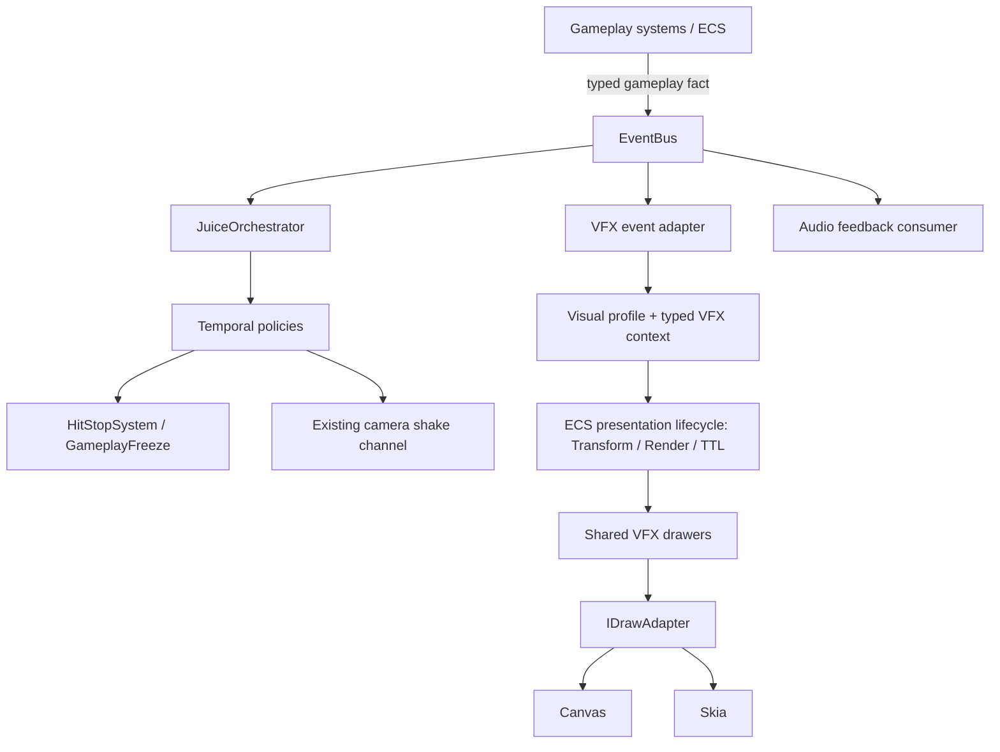

# Game Feel Architecture Contract

**Status:** Normative target architecture  
**Scope:** Gameplay events, temporal coordination, visual effects, audio feedback and renderer presentation across ArcadeGames  
**Implementation policy:** Incremental migration; this contract does not claim that the current runtime already conforms

## 1. Purpose

This document defines the ownership boundaries for Game Feel in ArcadeGames. It is the normative reference for new work and for incremental consolidation of existing feedback paths.

The architecture has five independent responsibilities:

1. **Gameplay determines what happened.**
2. **EventBus communicates typed gameplay facts.**
3. **JuiceOrchestrator coordinates temporal responses.**
4. **VFX owns visual representation; Audio owns sound presentation.**
5. **Canvas and Skia present equivalent visual output.**

A gameplay fact can have multiple independent consumers. JuiceOrchestrator is not a mandatory intermediary between gameplay and visual or audio feedback.

### 1.1 Canonical flow

The EventBus consumers are peers:

- JuiceOrchestrator decides **when and for how long** temporal feedback acts.
- VFX decides **what visual representation** a gameplay fact produces.
- Audio decides **what sound cue** represents that fact and how it is presented.

The channels may react to the same fact, but none owns or invokes another channel's implementation. Canvas and Skia are alternative backends for the same visual definition, not separate effect implementations.

## 2. Normative ownership contract

| Layer | Owns | Must not own |
|---|---|---|
| Gameplay / ECS | Authoritative state transitions, collision outcomes, damage, movement, entity lifecycle and gameplay meaning | Visual/audio instructions, primitive names, palettes, particle geometry, camera shake rendering |
| EventBus | Typed publication and delivery of gameplay facts; immediate/deferred dispatch through the existing API | Gameplay rules, temporal policy, VFX/audio selection or drawing |
| JuiceOrchestrator | Temporal response policy: hit-stop requests, shake envelopes, priorities, cooldowns and coordination between temporal channels | Effect selection, VFX profiles, visual/audio entity creation, Render/TTL, drawer registration or drawing |
| VFX | Mapping gameplay facts to visual descriptors, typed family context, semantic profiles, composition and visual presentation entities | Damage, collision validity, forces, movement, gameplay clocks, hit-stop policy or authoritative gameplay state |
| Audio feedback | Mapping gameplay facts to audio cues and controlling playback, voice limits, gain and audio accessibility | Gameplay rules, temporal freeze policy, visual effect selection or drawing |
| Canvas / Skia | Backend-specific execution of the shared drawing contract | Gameplay semantics, event interpretation, per-backend effect designs or independent effect timing |
| Accessibility preference source | Persisting user-selected accessibility preferences at the application/settings boundary | Deciding how each feedback channel implements its presentation adaptation |
| Visual Lab | Inspection and reproducible presentation of production VFX definitions | A parallel production drawer registry, gameplay simulation or alternative renderer implementation |

### 2.1 Gameplay systems

Gameplay systems are the sole authority for deciding that a meaningful event occurred.

A gameplay system must:

- Complete or commit the relevant gameplay transition before publishing its event.
- Publish a typed domain fact such as `combat:hit`, `combat:death`, `locomotion:slide_started` or `CollectiblePickedUp`.
- Include semantic information consumers cannot safely recover later, such as source/target identity, impact position, direction, material or gameplay-defined severity, where relevant.
- Remain correct when no VFX, audio or Juice consumer is registered.

A gameplay system must not publish a renderer or audio instruction such as `spawn pixelfx_explosion`, choose a palette, decide a TTL, request a sound filename or call a drawer. It must not create an event solely to make a particular effect appear. Events describe things that happened in gameplay; they are not visual/audio commands disguised as domain events.

A gameplay event may contain a semantic classification such as attack strength, damage tier, surface type or interaction result when that classification is genuinely part of the domain. It must not contain presentation choices such as shake amplitude, visual scale, tint, TTL, sound asset ID or renderer-specific objects.

### 2.2 EventBus

The existing typed EventBus is the communication boundary between gameplay producers and feedback consumers.

Its responsibilities are limited to:

- Typed event names and payload delivery.
- Immediate or deferred dispatch through the existing EventBus API.
- Subscription and unsubscription lifecycle.

The EventBus does not decide what an event means visually, temporally or acoustically. It must not depend on JuiceOrchestrator, VFX drawers, audio implementations, Canvas or Skia.

Event payloads carry facts and semantic context, not presentation policy. Prefer fields such as `entity`, `sourceEntity`, `targetEntity`, `x`, `y`, `direction`, `surface`, `material` or a gameplay-defined `severity`. Do not put `effectName`, `tint`, `ttl`, `shakeIntensity`, `soundName` or renderer-specific objects in gameplay event payloads.

The EventBus provides dispatch, not exactly-once delivery, durable event history, rollback compensation or prediction confirmation. Consumers must not infer any of those semantics from `emit` or `emitDeferred`.

Consumers must not depend on handler registration order to establish gameplay semantics. Required temporal ordering belongs in an explicit temporal policy, not in accidental subscription order.

### 2.3 JuiceOrchestrator — temporal coordination only

JuiceOrchestrator consumes gameplay facts and resolves their temporal response. It may coordinate:

- Hit-stop duration, priority, ownership and cooldown requests.
- Screen-shake intensity and duration envelopes through the existing camera feedback channel.
- Synchronization or sequencing between supported temporal channels.
- Accessibility policy for temporal feedback, such as shake suppression or scaling of camera motion.

Hit-stop continues through the existing canonical route: Juice policy requests are resolved by HitStopSystem and core GameplayFreeze. GameplayFreeze and the core scheduler remain authoritative for simulation freeze. JuiceOrchestrator must not create another freeze clock.

For rollback/resimulation, authoritative hit-stop requests must be replayed according to the established snapshot/scheduler contract. Presentation-only outputs such as duplicate shake impulses must not be emitted again during replay.

JuiceOrchestrator must not:

- Select a VFX primitive, audio cue or visual profile.
- Construct a VFX descriptor.
- Create an effect entity or write `Transform`, `Render` or `TTL` components.
- Register drawers or depend on `IDrawAdapter`, Canvas, Skia or PixelFX effect modules.
- Own effect progress, particle composition, visual lifetime or audio playback.

The camera/presentation system remains responsible for rendering camera displacement. JuiceOrchestrator coordinates the temporal request; it does not draw the shake.

### 2.4 VFX — visual representation only

VFX consumes gameplay facts independently of JuiceOrchestrator and translates their meaning into a visual representation.

VFX owns:

- Mapping gameplay event types and semantic context to effect identities and compositions.
- Typed family contexts (for example combat, traversal, interaction and temporal presentation).
- Semantic visual profiles and theme-token resolution.
- Placement and orientation derived from actual gameplay context.
- Creation and lifecycle of transient presentation entities through the existing ECS path.
- Visual accessibility adaptation (flash suppression, reduced visual intensity, motion reduction, density and contrast adjustments).
- Deterministic visual variation and visual admission control.

VFX must not decide whether a hit, death, pickup, landing or dash occurred. It must not change health, movement, physics, collision, gameplay RNG or simulation time. A VFX failure or missing renderer must never invalidate the gameplay event.

Transient procedural effects continue to use existing ECS presentation components such as `Transform`, `Render` and `TTL`. TTL remains the existing lifetime mechanism; this contract does not authorize a parallel particle engine, lifetime manager or scheduler.

VFX definitions receive semantic, typed context rather than a universal untyped payload. A drawer receives resolved presentation state and draws it; it does not query gameplay rules to decide whether an effect is valid.

VFX modules must not import runtime behavior or type definitions from JuiceOrchestrator. Shared visual identities and contracts belong to the VFX/presentation domain or to a narrowly justified neutral contract module. This includes removing the current type-level dependency where `VFXEffectIR` imports `SharedVFXPrimitiveName` from `JuiceOrchestrator`.

### 2.5 Audio — sound presentation only

Audio is an independent EventBus consumer. It maps gameplay facts and their semantic context to sound cues and owns audio playback, voice/concurrency limits, gain, spatialization and audio accessibility.

Gameplay systems must not choose audio asset IDs or call the audio playback implementation. A gameplay event must not be named or shaped as a sound command.

The existing `PlaySFX` event is a presentation command, not a domain fact. It may remain as an internal compatibility/playback API during migration, but new gameplay feedback integrations should consume typed gameplay facts and resolve audio cues inside the audio presentation boundary.

Audio output must be suppressed during rollback resimulation. Speculative audio must not be played irreversibly before the originating gameplay event is confirmed, unless the audio runtime supports cancellation keyed to the same stable event occurrence identity used by VFX.

### 2.6 Canvas and Skia — equivalent presentation

A visual effect has one semantic definition and one composition contract. Canvas and Skia are backends for presenting that definition.

The shared boundary remains `IDrawAdapter` from `DrawAdapter.ts`. Effect drawers depend on the adapter contract, not on `CanvasRenderingContext2D` or Skia APIs directly.

Both backends must preserve equivalent:

- Geometry, silhouette and relative proportions.
- Coordinate space, transforms, orientation and scale.
- Layering and draw order.
- Alpha, stroke/fill intent and semantic color.
- Progress and lifetime sampling.
- Visibility and edge-case behavior for missing or expired entities.

Pixel-identical raster output is not required where backend rasterization differs. Semantic and geometric equivalence is required and must be tested with tolerances appropriate to the operation.

A backend-specific bug belongs in its adapter implementation unless the shared effect definition itself is wrong. Do not fork an effect composition to compensate for an adapter defect.

### 2.7 Accessibility preference source and channel ownership

The application/settings boundary owns the user's accessibility preferences and their persistence. It does not implement visual, temporal or audio effects.

Each feedback consumer applies the relevant preferences within its own domain:

- JuiceOrchestrator adapts temporal responses such as camera shake and other temporal motion.
- VFX adapts flashes, luminance, contrast, effect density, visual intensity and visual motion.
- Audio adapts gain, dynamic range or other supported sound presentation settings.

All channels read the same authoritative user preference values. They must not maintain conflicting per-subsystem copies of the user's settings. A preference may affect more than one channel, but each channel remains responsible for applying it to its own output.

Accessibility adaptation must not change gameplay outcomes, hit validity, damage, movement, authoritative hit-stop duration or rollback state. Reduced-stimulation behavior must be testable independently for temporal, visual and audio output.

### 2.8 Visual Lab

Visual Lab is a development and review surface over the production effect definitions, profiles and drawers.

It must:

- Invoke the same production drawer functions used by games.
- Use the same `IDrawAdapter` implementations and registration contracts.
- Make a scenario reproducible through stable effect identity, profile, semantic context, seed/variant, dimensions, renderer and sampled presentation time.
- Support review at meaningful temporal samples, including start, peak and dissipation.
- Expose accessibility settings used by the scenario.

It must not maintain a second production effect implementation, independent timing engine or alternative renderer registry. A preview is evidence of a visual definition, not proof of a live gameplay integration.

## 3. Contracts between feedback channels

### 3.1 Event contract

A feedback-relevant event must satisfy all of the following:

1. It names a real gameplay fact, not a desired visual/audio result.
2. It has a typed payload in the owning game's EventRegistry.
3. It is emitted at a defined point in the gameplay transition.
4. It represents one logical occurrence in the authoritative gameplay history.
5. Its payload contains enough stable semantic context for consumers to react safely.
6. It does not contain visual, temporal or audio presentation policy.

If an effect requires information that is lost when the entity is destroyed, the producer includes the relevant immutable snapshot (for example position, direction, material or severity) in the gameplay event. VFX and Audio must not depend on querying a destroyed or already-mutated entity.

### 3.2 Coherence between temporal, visual and audio responses

The channels are independently owned, but they must remain coherent for the same gameplay fact.

The source of coherence is the **shared semantic meaning of the event**, not one subsystem invoking another and not a monolithic catalog containing renderer and audio details.

For events with meaningful intensity or severity, the gameplay domain publishes one semantic classification (for example `light`, `normal`, `heavy` or `critical`). Juice, VFX and Audio independently map that same classification to their own response:

- Temporal response: hit-stop and shake envelope.
- Visual response: effect identity/profile, scale and visual lifetime.
- Audio response: cue, gain and playback policy.

For events without a natural severity dimension, use their typed event meaning and context; do not invent a universal numeric intensity field.

A cross-channel conformance test must exercise the same representative event/context and assert the expected temporal, visual and audio responses as one scenario. The test should catch mismatches such as a domain-classified critical impact resolving to a low-intensity shake or an imperceptible VFX. Each channel also retains focused unit tests for its own resolver.

The mappings remain independently implemented and owned. The conformance fixture/test is the explicit coupling point; no channel calls another channel's resolver.

### 3.3 Temporal response contract

Temporal response maps are separate from visual and audio response maps.

The eventual configuration model must keep these concerns distinct:

- **Temporal response:** hit-stop, priority, cooldown and shake envelope.
- **Visual response:** effect identity, semantic family, visual profile, placement, scale and visual lifetime.
- **Audio response:** sound cue and playback properties.

One gameplay event may have all responses, only one response or none. A visual effect is not required to trigger hit-stop; hit-stop is not required to spawn a visual effect; audio is not required for either.

### 3.4 Visual descriptor contract

A VFX descriptor identifies:

- A stable effect ID.
- A semantic family.
- A typed family context.
- A semantic visual profile.
- Optional resolved presentation placement and deterministic variation input.
- The presentation-time policy, where it differs from the default.

The descriptor is presentation data. It cannot grant authority to alter gameplay. Its exact TypeScript shape evolves from real consumers rather than introducing a general-purpose visual scripting runtime.

### 3.5 Time domains and hit-stop behavior

The implementation distinguishes three separate concepts:

- **Simulation time:** advances authoritative gameplay and is controlled by the ECS schedule. During hit-stop, normal gameplay/simulation systems are suspended according to the core scheduler.
- **Presentation time:** advances visual-only animation and presentation systems. It is not automatically frozen by gameplay hit-stop.
- **Effect lifetime:** bounds the existence of a transient presentation entity. It is represented by the existing ECS TTL component and decremented by TTLSystem.

**Default hit-stop policy: presentation advances.** A global GameplayFreeze freezes gameplay simulation, not the presentation clock. VFX progress and TTL continue to advance by the frame delta during hit-stop; a short effect may therefore reach its peak or expire while gameplay remains frozen. This is intentional default behavior for impact readability and avoids extending every effect merely because gameplay was frozen.

An effect must not silently assume that TTL freezes with gameplay. If a future effect has a strong requirement to hold its visual pose during hit-stop, that must be an explicit presentation-time policy supported by a tested clock/pause mechanism. Do not add a second scheduler or modify authoritative simulation time to achieve it. Until that mechanism exists, the default `advance-during-hit-stop` policy applies.

Required regression coverage includes a scheduler test proving TTL-backed visual progress continues during GameplayFreeze, an expiry test proving an effect may expire before the freeze ends, and a separate explicit-pause test. Any future hold/freeze policy must add its own deterministic clock and restore tests before use.

Explicit application pause is a separate policy from hit-stop. Its effect on TTL, visual animation, shake and audio must be defined and tested at the relevant application boundary; it must not be inferred from the hit-stop rule.

TTL is a lifetime bound, not a universal clock abstraction. Drawers may derive normalized progress from TTL while it remains the chosen lifetime contract, but must not treat TTL as simulation time.

### 3.6 Rollback, resimulation and prediction

The system distinguishes a repeated execution of a logical event from a second logical occurrence.

**Resimulation rule:**

- EventBus may deliver an event again while corrected simulation frames are replayed. This does not represent a new gameplay occurrence.
- Authoritative gameplay state and snapshot-managed temporal requests must be replayed according to the rollback contract.
- Presentation side effects must not be emitted again during resimulation.
- `world.isReSimulating` is the authoritative execution-state signal.

The suppression mechanism belongs at each presentation side-effect boundary:

- The VFX event consumer checks `world.isReSimulating` before creating/enqueuing presentation output.
- The public VFX runtime/spawn boundary enforces the same guard centrally, so a direct or future caller cannot bypass it.
- The Audio playback boundary suppresses sound during resimulation.
- JuiceOrchestrator preserves the established distinction: replay authoritative hit-stop requests where required, but suppress shake and other presentation-only output.

The flag is checked by the consumer/runtime at the boundary, not copied into a gameplay event payload or stored in a VFX descriptor. Draw adapters and pure drawers do not query the scheduler or World to make rollback decisions. They render the presentation entities that legitimately exist.

**Prediction/retraction rule:**

A predicted event may later be invalidated by rollback. EventBus dispatch alone does not provide compensation. The response is different for snapshot-managed temporal state and irreversible presentation output:

1. **Hit-stop:** a predicted hit-stop request may be applied only through the canonical snapshot-managed `GameplayFreeze` and `JuiceHitStopPolicy` state. Rollback must restore both resources to the pre-event snapshot; corrected replay reissues the request only if the corrected gameplay history still contains the event. If either state is not restored deterministically, defer the request until confirmation.
2. **Shake, VFX and Audio:** these are presentation side effects. By default, emit them only when the originating event is confirmed/committed for presentation. In non-predicted local gameplay, the authoritative transition may be considered immediately confirmed.
3. Optimistic shake/VFX/audio is permitted only when the runtime supports cancellation/reconciliation keyed by a stable event-occurrence ID and rollback explicitly retracts or replaces invalidated output.
4. A stable occurrence ID must survive re-execution of the same logical event during replay. It must not be based on wall-clock time, a transient callback identity or entity ID alone.
5. Until confirmation or keyed cancellation/retraction is implemented and tested, speculative presentation is a blocker, not an undocumented exception.

**Required regression coverage:**

- Replaying the same gameplay event during `world.isReSimulating` must not create a VFX entity, play audio or add a second shake impulse.
- A hit-stop request that belongs to the corrected authoritative history must be reproduced during replay.
- A hit-stop request from a rolled-back prediction must disappear when `GameplayFreeze` and `JuiceHitStopPolicy` are restored to the earlier snapshot.
- A corrected, confirmed event produces exactly one set of VFX/audio outputs.
- If optimistic output is ever enabled, rollback must cancel the output associated with the invalidated stable occurrence ID and retain/recreate output for the corrected occurrence.

This does not require a global exactly-once EventBus. The gameplay producer owns prevention of duplicate logical transitions in one authoritative history; consumers own suppression of replay side effects and idempotency for confirmed delivery where needed.

### 3.7 Determinism and randomness

- Gameplay RNG is reserved for authoritative gameplay. Presentation variation uses an explicit stable seed or deterministic derivation and must not consume gameplay RNG.
- The same event occurrence, visual descriptor, profile, seed and sampled presentation time must produce the same visual result.
- A resimulation must not duplicate VFX, shake or audio.
- Transient presentation state remains in the existing ECS lifecycle. No parallel entity manager or particle lifecycle is permitted.
- No VFX drawer may mutate gameplay components or authoritative resources.
- Accessibility preferences may adapt presentation but must not change authoritative damage, collision, movement or freeze duration.

## 4. Module boundaries and shared contracts

### 4.1 Neutral contract module — strict admission criteria

A neutral module is allowed only when a contract genuinely needs to be shared by at least two independently owned subsystems.

Every exported symbol must satisfy all of these criteria:

1. It represents stable domain meaning or an immutable cross-boundary data contract.
2. At least two independently owned consumers require the exact same semantic type or value.
3. It contains no runtime orchestration, mutable state, service, callback registry, event subscription or side effect.
4. It imports no concrete implementation from Juice, VFX, Audio, a game, Canvas or Skia.
5. It does not become the home of unrelated types merely because multiple modules can import it.

Types used only by one subsystem stay local. Gameplay event payload types stay with the owning domain/game EventRegistry or gameplay-kit domain. Renderer-specific types stay with the renderer. Temporal policy types stay with Juice. VFX descriptors and profile types stay with VFX. Audio cue types stay with Audio.

A neutral contract must have a narrow name and documented consumers. A proposed symbol without two real consumers is not admitted. If no valid shared contract exists, use a small explicit mapping at each owner boundary rather than creating a generic `shared`, `common` or `utils` dumping ground.

### 4.2 Dependency direction

Allowed conceptual dependencies:

- Gameplay systems → typed gameplay EventRegistry contracts.
- EventBus → registered handlers, without depending on their implementations.
- JuiceOrchestrator → typed gameplay event contracts and existing core temporal/camera channels.
- VFX event adapters → typed gameplay event contracts and VFX presentation contracts.
- Audio feedback → typed gameplay event contracts and Audio presentation contracts.
- VFX drawers → `IDrawAdapter` and read-only presentation state.
- CanvasDrawAdapter / SkiaDrawAdapter → their respective rendering APIs.

Forbidden dependencies:

- Gameplay → VFX drawer, renderer, audio asset or visual profile.
- EventBus → JuiceOrchestrator, VFX or Audio implementation.
- JuiceOrchestrator → VFX primitive catalog, drawer, Render/TTL entity creation or renderer.
- VFX → JuiceOrchestrator or Audio implementation.
- Audio → JuiceOrchestrator or VFX implementation.
- Effect drawer → Canvas or Skia concrete API.
- Canvas/Skia → gameplay event registry or gameplay rules.

If a type is required by more than one independently owned subsystem, apply the neutral-module admission criteria before extracting it.

## 5. VFX capacity, lifecycle and performance budgets

VFX owns admission control for visual effects. Gameplay events must never be dropped or delayed because a visual budget is exhausted.

Before broadening production integration, each game/scene must have a measured budget for:

- New VFX entities or effect requests per frame.
- Concurrent live transient VFX entities.
- Draw operations/draw calls attributable to VFX.
- CPU time and, where measurable, GPU/frame-time contribution.
- Allocation and garbage-collection pressure in representative burst scenarios.

Budgets are established from representative gameplay scenes and target-device measurements, not guessed constants. The absence of a measured baseline is recorded as `unknown`; it is not evidence of an unlimited budget.

When a budget is reached, VFX applies deterministic admission/degradation rules:

1. Preserve critical/high-semantic-value feedback ahead of cosmetic/ambient output.
2. Use stable priority and occurrence ordering to decide which optional effects are admitted.
3. Prefer controlled degradation (reduced detail, merged/coalesced bursts or lower-cost composition) over silently losing all feedback.
4. Never feed budget rejection back into gameplay state or EventBus fact delivery.
5. Record counters for requested, admitted, degraded and rejected effects so the budget can be tuned empirically.

Pooling is not mandatory. Introduce or change pools only when profiling shows that allocation/GC cost is material and the pool can preserve deterministic lifecycle, renderer safety and correct reset semantics. Do not claim zero-allocation or add a pool based only on source inspection.

## 6. Incremental migration plan and approval gates

Migration is sequential, evidence-based and reversible. Existing integrations continue working until an equivalent replacement is verified.

### Step 0 — Complete the inventory and obtain approval

- Treat this document as the normative ownership reference.
- Keep `docs/agents/vfx-ledger.md` as the evidence ledger for individual VFX effects and integrations.
- Keep `docs/agents/juice-consolidation-ledger.md` as the evidence ledger for temporal/legacy Juice paths.
- Keep `docs/agents/game-feel-architecture-ledger.md` as the cross-layer implementation baseline and ownership-gap ledger.
- Audit one effect or one system per unit of work.
- Record real event producers, subscribers, temporal response, VFX response, audio response, ECS lifecycle, Canvas/Skia registration, tests, Visual Lab scenario, resimulation and prediction behavior.
- Phase 0 remains open until the complete inventory is reconciled, no unresolved `unknown` or `blocked` entries remain in scope, and the user approves the inventory.

**No runtime pilot or migration starts before this approval.** Documentation and source-only audits may continue. Asteroids `combat:death` / `rock:destroyed` is only a candidate for the first pilot, not an approved implementation target. After Phase 0 approval, choose and approve the pilot event explicitly.

### Step 1 — Separate configuration and type boundaries

- Split the current mixed `JUICE_CATALOG` responsibility into distinct temporal, visual and (where required) audio response mappings.
- Move visual primitive/effect identities and descriptor types out of JuiceOrchestrator.
- Make JuiceOrchestrator consume gameplay facts only for temporal coordination.
- Make VFX consume the same gameplay facts independently for visual response.
- Make Audio consume the same gameplay facts independently for sound presentation.
- Preserve common semantic severity/context so separate responses remain coherent and cover it with cross-channel conformance tests.
- Keep existing behavior available during migration where needed; do not perform a big-bang rewrite.

The exact API names and subscription ownership are implementation decisions to be made against audited call sites. Do not create a generic plugin system or universal event-to-graph engine.

### Step 2 — Migrate one approved real event as a pilot

The pilot is selected only after Step 0 approval.

1. The gameplay producer publishes one typed fact.
2. The temporal subscriber resolves only temporal feedback.
3. The VFX subscriber resolves only visual feedback.
4. The Audio subscriber resolves only sound feedback, if applicable.
5. The VFX runtime uses the existing ECS lifecycle.
6. The same drawer composition is registered for Canvas and Skia.
7. Focused tests prove event-to-temporal and event-to-visual/audio paths independently and together.
8. Rollback tests prove resimulation suppression and the chosen prediction confirmation/retraction policy.
9. Visual Lab provides a reproducible scenario for the visual effect.
10. Capacity counters/budgets are recorded under a representative burst.

After the first integrated effect in a new family (traversal, interaction or environmental), stop for review before integrating a second effect in that family.

### Step 3 — Expand incrementally

- Migrate one effect or one integration slice per unit.
- Prefer real gameplay facts over direct visual/audio calls.
- Preserve game-specific behavior when it is genuinely specialized; do not force every effect into one universal implementation.
- Require measurable evidence before performance refactors or pooling.
- Keep sprite-sheet and procedural VFX inventories separate.

### Step 4 — Retire legacy paths safely

Before deleting or replacing a legacy feedback path:

- Search all producers and consumers.
- Verify event coverage, cross-channel coherence, rollback and prediction semantics.
- Prove the replacement produces equivalent temporal, visual and audio behavior.
- Add or update focused and cross-channel tests.
- Remove the legacy path only after the evidence is complete.

Do not remove a path merely because a new abstraction exists.

## 7. Definition of done for an integrated feedback event

An event integration is complete only when all applicable evidence exists:

- A real gameplay transition publishes a typed EventBus fact.
- The event is not emitted solely to request a visual or sound.
- Temporal response is owned by JuiceOrchestrator and does not select or create VFX/audio.
- Visual response is owned by VFX and does not alter gameplay or temporal policy.
- Audio response is owned by Audio and does not alter gameplay or visual state.
- A common semantic event classification keeps the channels aligned where applicable.
- Cross-channel conformance tests assert the intended combined response.
- ECS presentation lifecycle is used without a second lifetime manager.
- Production drawers behave equivalently on Canvas and Skia.
- Hit-stop time-domain behavior is explicitly tested for effects whose timing matters.
- Rollback/resimulation does not duplicate presentation output and preserves required authoritative temporal behavior.
- Predicted presentation is confirmed before output or supports stable-ID cancellation/retraction.
- Accessibility adaptations are covered for temporal, visual and audio channels.
- VFX capacity counters and representative budgets are recorded; overload degradation is deterministic.
- A reproducible Visual Lab or in-game scenario exists for meaningful visual effects.
- Typecheck, focused tests, CI/ratchet and duplication checks pass according to repository policy.

A drawer existing in source, a catalog entry, a test fixture or a Visual Lab preset alone is not proof of a complete gameplay integration.

## 8. Change control and decision rules

- A change that moves responsibility across these boundaries must update this contract or an associated decision record.
- If an implementation requires JuiceOrchestrator to create/render VFX, VFX to request hit-stop directly, or gameplay to select an audio asset, stop and resolve the ownership conflict before coding.
- If a requirement cannot be expressed with the existing EventBus, ECS lifecycle, temporal channels, audio service or draw adapter, present the smallest missing contract and alternatives before introducing infrastructure.
- If TTL pause behavior, speculative rollback compensation or a visual-time policy is not implemented and tested, treat the affected use case as blocked; do not infer support from the architecture diagram.
- Do not merge a pull request without explicit authorization.
- Report source evidence and actual test execution separately. A GitHub source inspection is not a local test run.

## 9. Related records

- `docs/agents/vfx-ledger.md` — per-effect VFX audit and integration evidence.
- `docs/agents/juice-consolidation-ledger.md` — temporal/legacy Juice audit history and phase status.
- `docs/agents/game-feel-architecture-ledger.md` — cross-layer runtime baseline, time/rollback evidence and unresolved ownership gaps.
- `docs/audit/vfx-effects-inventory.md` — procedural and sprite-sheet effect inventory.
- `docs/audit/vfx-architecture-audit.md` — source-level VFX architecture findings.
- `docs/specs/vfx-architecture-2.0-decisions.md` — earlier design decisions; its former combined JuiceOrchestrator spawn/event guidance is superseded by this ownership contract.
