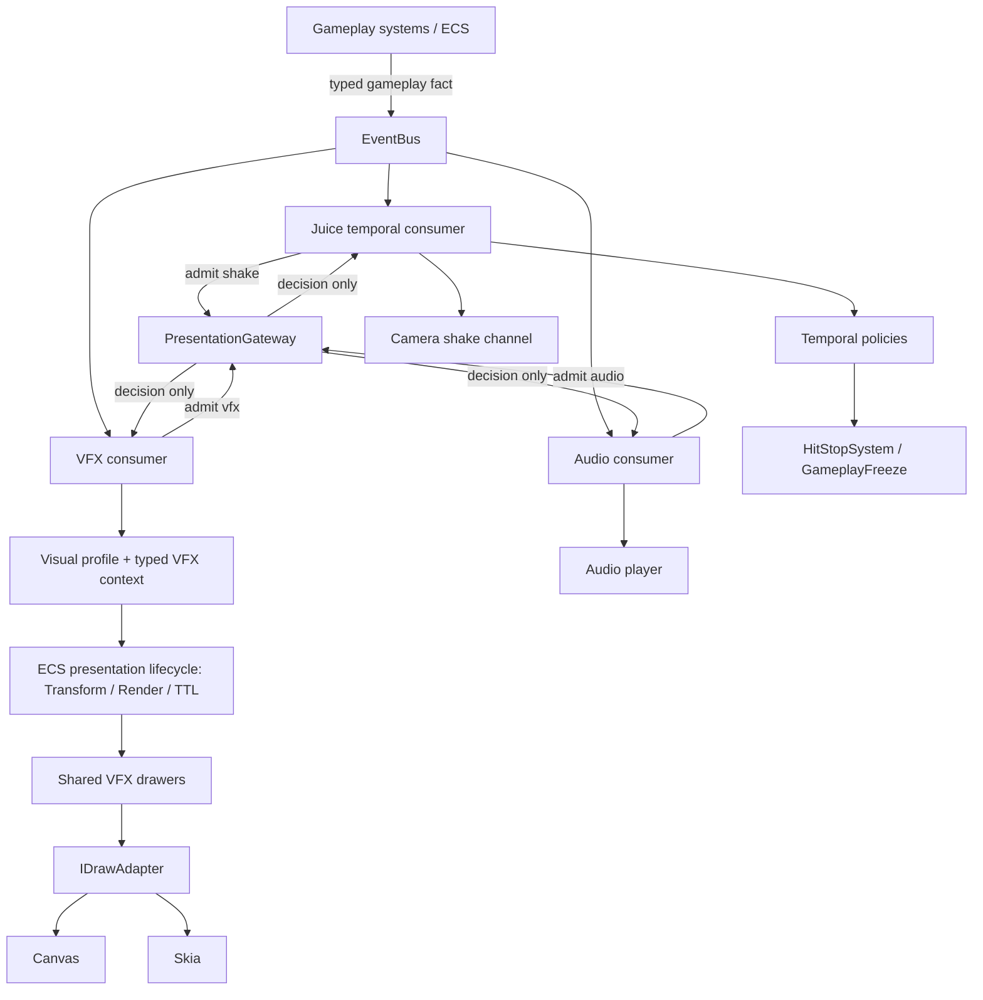

# Game Feel Architecture Contract

**Status:** Normative target architecture  
**Scope:** Gameplay events, temporal coordination, visual effects, audio feedback and renderer presentation across ArcadeGames  
**Implementation policy:** Incremental migration; this contract does not claim that the current runtime already conforms

## 1. Purpose

This document defines the ownership boundaries for Game Feel in ArcadeGames. It is the normative reference for new work and for incremental consolidation of existing feedback paths.

The architecture has five responsibilities with a deliberately narrow shared presentation boundary:

1. **Gameplay determines what happened.**
2. **EventBus communicates typed gameplay facts.**
3. **JuiceOrchestrator coordinates temporal responses.**
4. **PresentationGateway guards admission; each presentation consumer independently resolves and emits its own output.**
5. **Canvas and Skia present equivalent visual output.**

A gameplay fact may produce temporal, visual and audio responses. Those responses remain separately owned. PresentationGateway is a shared admission guard consulted by the VFX, Audio and shake consumers at their own side-effect boundaries. It does not subscribe to the EventBus, dispatch events, route output or execute effects. Authoritative hit-stop remains outside this guard.

### 1.1 Canonical flow



Ownership is split as follows:

- JuiceOrchestrator decides **when and for how long** temporal feedback acts.
- PresentationGateway decides **whether a logical presentation emission is admitted or suppressed**. The requesting consumer performs its own side-effect after an admission decision; the Gateway does not route or dispatch it.
- VFX decides **what visual representation** the gameplay fact produces.
- Audio decides **what sound cue** represents the gameplay fact and how it is presented.

The gateway must not choose effects, sound assets, colors, temporal policies or rendering behavior. Canvas and Skia remain alternative backends for the same visual definition, not separate effect implementations.

## 2. Normative ownership contract

| Layer | Owns | Must not own |
|---|---|---|
| Gameplay / ECS | Authoritative state transitions, collision outcomes, damage, movement, entity lifecycle and gameplay meaning | Visual/audio instructions, primitive names, palettes, particle geometry, camera shake rendering |
| EventBus | Typed publication and delivery of gameplay facts; immediate/deferred dispatch through the existing API | Gameplay rules, temporal policy, VFX/audio selection or drawing |
| JuiceOrchestrator | Temporal response policy: hit-stop requests, shake envelopes, priorities, cooldowns and coordination between temporal channels | Effect selection, VFX profiles, visual/audio entity creation, Render/TTL, drawer registration or drawing |
| PresentationGateway | Admission/suppression decision for VFX, Audio and shake emissions; resimulation guard and logical-emission deduplication | Event subscription, dispatch/routing, queues, effect/cue selection, composition, sound assets, temporal policy or renderer behavior |
| VFX | Resolving admitted gameplay facts into visual descriptors, typed family context, semantic profiles, composition and visual presentation entities | Damage, collision validity, forces, movement, gameplay clocks, hit-stop policy or bypassing PresentationGateway |
| Audio feedback | Resolving admitted gameplay facts into audio cues and controlling playback, voice limits, gain and audio accessibility | Gameplay rules, temporal freeze policy, visual effect selection or bypassing PresentationGateway |
| Canvas / Skia | Backend-specific execution of the shared drawing contract | Gameplay semantics, event interpretation, per-backend effect designs or independent effect timing |
| Accessibility preference source | Persisting user-selected accessibility preferences at the application/settings boundary | Deciding how each feedback channel implements its presentation adaptation |
| Visual Lab | Inspection and reproducible presentation of production VFX definitions | A parallel production drawer registry, gameplay simulation or alternative renderer implementation |

### 2.1 Gameplay systems

Gameplay systems are the sole authority for deciding that a meaningful event occurred.

A gameplay system must:

- Complete or commit the relevant gameplay transition before publishing its event.
- Publish a typed domain fact such as `combat:hit`, `combat:death`, `locomotion:slide_started` or `CollectiblePickedUp`.
- Include semantic information consumers cannot safely recover later, such as source/target identity, impact position, direction, material or gameplay-defined severity, where relevant.
- Remain correct when no VFX, audio or Juice consumer is registered.

A gameplay system must not publish a renderer or audio instruction such as `spawn pixelfx_explosion`, choose a palette, decide a TTL, request a sound filename or call a drawer. It must not create an event solely to make a particular effect appear. Events describe things that happened in gameplay; they are not visual/audio commands disguised as domain events.

A gameplay event may contain a semantic classification such as attack strength, damage tier, surface type or interaction result when that classification is genuinely part of the domain. It must not contain presentation choices such as shake amplitude, visual scale, tint, TTL, sound asset ID or renderer-specific objects.

### 2.2 EventBus

The existing typed EventBus is the communication boundary between gameplay producers and feedback consumers.

Its responsibilities are limited to:

- Typed event names and payload delivery.
- Immediate or deferred dispatch through the existing EventBus API.
- Subscription and unsubscription lifecycle.

The EventBus does not decide what an event means visually, temporally or acoustically. It must not depend on JuiceOrchestrator, PresentationGateway internals, VFX drawers, audio implementations, Canvas or Skia.

Event payloads carry facts and semantic context, not presentation policy. Prefer fields such as `entity`, `sourceEntity`, `targetEntity`, `x`, `y`, `direction`, `surface`, `material` or a gameplay-defined `severity`. Do not put `effectName`, `tint`, `ttl`, `shakeIntensity`, `soundName` or renderer-specific objects in gameplay event payloads.

The EventBus provides dispatch, not exactly-once delivery, durable event history, rollback compensation or prediction confirmation. Consumers must not infer any of those semantics from `emit` or `emitDeferred`. JuiceOrchestrator may consume domain facts for temporal policy. VFX, Audio and presentation shake side-effects must each request admission through PresentationGateway; authoritative hit-stop does not.

Consumers must not depend on handler registration order to establish gameplay semantics. Required temporal ordering belongs in an explicit temporal policy, not in accidental subscription order.

### 2.3 JuiceOrchestrator — temporal coordination only

JuiceOrchestrator consumes gameplay facts and resolves their temporal response. It may coordinate:

- Hit-stop duration, priority, ownership and cooldown requests.
- Screen-shake intensity and duration envelopes through the existing camera feedback channel.
- Synchronization or sequencing between supported temporal channels.
- Accessibility policy for temporal feedback, such as shake suppression or scaling of camera motion.

Hit-stop continues through the existing canonical route: Juice policy requests are resolved by HitStopSystem and core GameplayFreeze. GameplayFreeze and the core scheduler remain authoritative for simulation freeze. JuiceOrchestrator must not create another freeze clock.

For rollback/resimulation, authoritative hit-stop requests must be replayed according to the established snapshot/scheduler contract. Presentation-only outputs such as duplicate shake impulses must not be emitted again during replay.

JuiceOrchestrator must not:

- Select a VFX primitive, audio cue or visual profile.
- Construct a VFX descriptor.
- Create an effect entity or write `Transform`, `Render` or `TTL` components.
- Register drawers or depend on `IDrawAdapter`, Canvas, Skia or PixelFX effect modules.
- Own effect progress, particle composition, visual lifetime or audio playback.

The camera/presentation system remains responsible for rendering camera displacement. JuiceOrchestrator coordinates the temporal request; it does not draw the shake.

### 2.4 VFX — visual representation only

VFX consumes gameplay facts independently of JuiceOrchestrator and translates their meaning into a visual representation.

VFX owns:

- Mapping gameplay event types and semantic context to effect identities and compositions.
- Typed family contexts (for example combat, traversal, interaction and temporal presentation).
- Semantic visual profiles and theme-token resolution.
- Placement and orientation derived from actual gameplay context.
- Creation and lifecycle of transient presentation entities through the existing ECS path.
- Visual accessibility adaptation (flash suppression, reduced visual intensity, motion reduction, density and contrast adjustments).
- Deterministic visual variation and VFX-owned resource-budget control. This is separate from Gateway replay/deduplication admission.

VFX must not decide whether a hit, death, pickup, landing or dash occurred. It must not change health, movement, physics, collision, gameplay RNG or simulation time. A VFX failure or missing renderer must never invalidate the gameplay event.

Transient procedural effects continue to use existing ECS presentation components such as `Transform`, `Render` and `TTL`. TTL remains the existing lifetime mechanism; this contract does not authorize a parallel particle engine, lifetime manager or scheduler.

VFX definitions receive semantic, typed context rather than a universal untyped payload. A drawer receives resolved presentation state and draws it; it does not query gameplay rules to decide whether an effect is valid.

VFX modules must not import runtime behavior or type definitions from JuiceOrchestrator. Shared visual identities and contracts belong to the VFX/presentation domain or to a narrowly justified neutral contract module. This includes removing the current type-level dependency where `VFXEffectIR` imports `SharedVFXPrimitiveName` from `JuiceOrchestrator`.

### 2.5 Audio — sound presentation only

Audio owns cue resolution and sound presentation: asset selection, playback, voice/concurrency limits, gain, spatialization and audio accessibility.

The Audio consumer subscribes directly to the EventBus like the other consumers. It resolves a gameplay fact into an Audio-owned cue, then queries PresentationGateway on the `audio` channel immediately before playback. Gameplay systems must not choose audio asset IDs or call playback APIs. A gameplay event must not be named or shaped as a sound command.

The existing `PlaySFX` event is a presentation command, not a domain fact. It may remain as an internal compatibility/playback API during migration, but new gameplay feedback integrations must resolve sound from typed gameplay facts and submit playback through PresentationGateway.

Audio must not expose a gameplay-facing playback path that bypasses PresentationGateway. The consumer performs playback only after its own admission request returns `admit`; the Gateway does not dispatch or invoke the audio player. A sound that has already become audible cannot be undone; speculative audio is therefore disabled by default and may be enabled only where the audio engine can cancel the scheduled voice by stable occurrence ID before it becomes audible.

### 2.6 PresentationGateway — admission guard, not router

PresentationGateway is a narrow guard consulted by each presentation consumer. It is not a subscriber, event router, dispatcher, queue or presentation orchestrator.

Each consumer remains subscribed directly to the EventBus and calls the Gateway immediately before a logical side-effect:

- VFX requests admission on channel `vfx` before creating a logical visual emission.
- Audio requests admission on channel `audio` before playback or scheduling a voice.
- Juice/camera requests admission on channel `shake` before applying a presentation shake impulse.

The Gateway returns an admission decision only. After `admit`, the requesting consumer remains responsible for selecting and executing its own output. An admission for one channel does not admit, suppress or dispatch another channel.

The initial local-authoritative contract is:

```ts
type PresentationChannel = "vfx" | "audio" | "shake";

interface OccurrenceRef {
  eventName: string;
  occurrenceId: string;
  tick: number;
}

interface PresentationEmissionRef {
  occurrence: OccurrenceRef;
  emissionId: string;
}

type AdmissionDecision =
  | { kind: "admit" }
  | { kind: "suppress"; reason: "resimulating" | "duplicate" };

interface PresentationGateway {
  admit(
    channel: PresentationChannel,
    emission: PresentationEmissionRef
  ): AdmissionDecision;
}
```

The final TypeScript shape may follow repository conventions, but these rules are normative:

- It checks execution mode and suppresses presentation output during full resimulation.
- It deduplicates by `(channel, occurrenceId, emissionId)`. Deduplicating only by occurrence would incorrectly suppress multiple legitimate emissions from one gameplay fact.
- It receives execution context through a read-only injected boundary. Consumers must not independently implement the `world.isReSimulating` guard.
- It does not subscribe to EventBus, dispatch or route events, own a queue/clock, or write gameplay state.
- It does not choose visual profiles, primitives, audio cues/assets, shake envelopes, colors, durations or renderer operations.
- It has no imports from Juice, VFX runtime, Audio, Canvas or Skia.
- The initial API does not expose `defer` or `retracted` without implemented confirmation/retention/cancellation semantics. Those remain conditional work for PR16.

**Occurrence identity dependency:** the current EventBus handler signature is `(payload, event)` and its deferred buffers retain only `{ event, payload }`. There is no published tick/sequence/occurrence metadata today. `World.tick` exists but is not connected to EventBus. A deterministic sidecar metadata contract must be implemented and tested before the Gateway can claim reliable occurrence deduplication. EventBus must not import World; its tick/context provider is injected from the World/runtime boundary. Metadata for deferred events is captured at publication, not at flush.

An occurrence may have multiple logical emissions in one channel. For example, `combat:death` may produce a composed `death-explosion` or separate `death-flash` and `death-ring` emissions. Deduplication applies to each logical emission, not to particles, primitives or draw calls within an emission.

**Hit-stop is excluded.** Authoritative hit-stop requests remain in Juice/HitStopSystem/GameplayFreeze and follow the rollback snapshot/replay contract. The Gateway protects only presentation shake impulses, VFX and audio.

Every public side-effect boundary must be protected by the guard. Enforce this with encapsulated/internal downstream APIs and architectural tests, not documentation alone. One Gateway check is made per logical emission, not once per particle or primitive.

The Gateway does not guarantee exactly-once EventBus delivery and must not be used as a substitute for removing duplicate producers. It provides idempotent admission at the presentation boundary.

### 2.7 Canvas and Skia — equivalent presentation

A visual effect has one semantic definition and one composition contract. Canvas and Skia are backends for presenting that definition.

The shared boundary remains `IDrawAdapter` from `DrawAdapter.ts`. Effect drawers depend on the adapter contract, not on `CanvasRenderingContext2D` or Skia APIs directly.

Both backends must preserve equivalent:

- Geometry, silhouette and relative proportions.
- Coordinate space, transforms, orientation and scale.
- Layering and draw order.
- Alpha, stroke/fill intent and semantic color.
- Progress and lifetime sampling.
- Visibility and edge-case behavior for missing or expired entities.

Pixel-identical raster output is not required where backend rasterization differs. Semantic and geometric equivalence is required and must be tested with tolerances appropriate to the operation.

A backend-specific bug belongs in its adapter implementation unless the shared effect definition itself is wrong. Do not fork an effect composition to compensate for an adapter defect.

### 2.8 Accessibility preference source and channel ownership

The application/settings boundary owns the user's accessibility preferences and their persistence. It does not implement visual, temporal or audio effects.

Each feedback consumer applies the relevant preferences within its own domain:

- JuiceOrchestrator adapts temporal responses such as camera shake and other temporal motion.
- VFX adapts flashes, luminance, contrast, effect density, visual intensity and visual motion.
- Audio adapts gain, dynamic range or other supported sound presentation settings.

All channels read the same authoritative user preference values. They must not maintain conflicting per-subsystem copies of the user's settings. A preference may affect more than one channel, but each channel remains responsible for applying it to its own output.

Accessibility adaptation must not change gameplay outcomes, hit validity, damage, movement, authoritative hit-stop duration or rollback state. Reduced-stimulation behavior must be testable independently for temporal, visual and audio output.

### 2.9 Visual Lab

Visual Lab is a development and review surface over the production effect definitions, profiles and drawers.

It must:

- Invoke the same production drawer functions used by games.
- Use the same `IDrawAdapter` implementations and registration contracts.
- Make a scenario reproducible through stable effect identity, profile, semantic context, seed/variant, dimensions, renderer and sampled presentation time.
- Support review at meaningful temporal samples, including start, peak and dissipation.
- Expose accessibility settings used by the scenario.

It must not maintain a second production effect implementation, independent timing engine or alternative renderer registry. A preview is evidence of a visual definition, not proof of a live gameplay integration.

## 3. Contracts between feedback channels

### 3.1 Event contract

A feedback-relevant event must satisfy all of the following:

1. It names a real gameplay fact, not a desired visual/audio result.
2. It has a typed payload in the owning game's EventRegistry.
3. It is emitted at a defined point in the gameplay transition.
4. It represents one logical occurrence in the authoritative gameplay history.
5. Its payload contains enough stable semantic context for consumers to react safely.
6. It does not contain visual, temporal or audio presentation policy.

If an effect requires information that is lost when the entity is destroyed, the producer includes the relevant immutable snapshot (for example position, direction, material or severity) in the gameplay event. VFX and Audio must not depend on querying a destroyed or already-mutated entity.

### 3.2 Coherence between temporal, visual and audio responses

The channels are independently owned, but they must resolve the same gameplay meaning.

For a combat hit, the domain may publish a typed semantic classification such as:

```ts
type ImpactSeverity = "light" | "normal" | "heavy" | "critical";
```

An `impactSeverity` field belongs in a combat event payload only when it describes the resolved gameplay event: for example, a damage/attack tier derived from actual damage, attack classification or a gameplay rule. Its thresholds and semantics are owned by the combat domain. It is not a display intensity, not a normalized visual scalar and not a request for a particular response.

Do not add a universal `severity` or `intensity` field to every event. Different domains should carry their own meaningful facts (for example `surface`, `pickupValueTier` or `interactionResult`) or rely on the typed event identity when no additional classification exists.

For one semantic occurrence, each channel maps the same domain classification independently:

- Juice maps `impactSeverity` to its temporal response (hit-stop/shake).
- VFX maps it to visual identity/profile/composition and the effect's time policy.
- Audio maps it to a sound cue and playback policy.

These mappings must not share a numeric scale. "Heavy" need not mean the same numeric value in milliseconds, pixels or decibels.

A cross-channel conformance test must use a table of domain inputs and explicit expected outputs. For example, each `ImpactSeverity` case has an expected temporal profile, VFX descriptor/profile and audio cue. Tests assert those exact resolver outputs and their shared input classification; they do not attempt to measure subjective "coherence" by comparing unrelated numeric intensities. Each channel also retains focused unit tests for its own resolver.

The conformance fixture is the explicit coupling point. No channel calls another channel's resolver, and no presentation policy is added to the gameplay event.

### 3.3 Temporal response contract

Temporal response maps are separate from visual and audio response maps.

The eventual configuration model must keep these concerns distinct:

- **Temporal response:** hit-stop, priority, cooldown and shake envelope.
- **Visual response:** effect identity, semantic family, visual profile, placement, scale and visual lifetime.
- **Audio response:** sound cue and playback properties.

One gameplay event may have all responses, only one response or none. A visual effect is not required to trigger hit-stop; hit-stop is not required to spawn a visual effect; audio is not required for either.

### 3.4 Visual descriptor contract

A VFX descriptor identifies:

- A stable effect ID.
- A semantic family.
- A typed family context.
- A semantic visual profile.
- Optional resolved presentation placement and deterministic variation input.
- The presentation-time policy, where it differs from the default.

The descriptor is presentation data. It cannot grant authority to alter gameplay. Its exact TypeScript shape evolves from real consumers rather than introducing a general-purpose visual scripting runtime.

### 3.5 Time domains and per-effect hit-stop policy

The implementation distinguishes three separate concepts:

- **Simulation time:** advances authoritative gameplay and is controlled by the ECS schedule. During hit-stop, normal gameplay/simulation systems are suspended according to the core scheduler.
- **Presentation time:** advances visual-only animation and presentation systems. It is not automatically frozen by gameplay hit-stop.
- **Effect lifetime:** bounds the existence of a transient presentation entity. The current implementation represents this with ECS TTL; TTL is a lifetime bound, not a universal clock abstraction.

**Hit-stop timing is selected per effect, not globally.** Each VFX definition must declare one of these policies:

| Policy | Meaning during hit-stop | Typical use |
|---|---|---|
| `advance` | Effect progress and lifetime continue at normal presentation rate (1×). | Sparks, short flashes or decorative responses that should continue immediately. |
| `freeze` | Effect progress and lifetime hold their current values until hit-stop ends (0×). | Contact poses, impact holds and compositions whose read depends on the frozen moment. |
| `scale(factor)` | Effect progress and lifetime advance at the declared fraction of normal presentation rate, where `0 < factor < 1`. | Slow-motion trails or energy effects that should continue, but more slowly. |

If an effect does not declare a policy, the compatibility default is `advance`. The choice belongs to the VFX effect definition/profile; a per-event override is allowed only when it is intentional, typed and covered by a reproducible scenario.

The selected policy applies consistently to both the effect's visible progress and its remaining lifetime. A drawer must not freeze its animation while TTL expires, or keep TTL alive while its normalized progress uses a different clock, unless that divergence is an explicitly designed effect behavior.

The current `TTLSystem` decrements TTL during `GameplayFreeze` using frame delta. Therefore `advance` is currently supported by the existing path. `freeze` and `scale(factor)` are **target policies, not claims about current runtime capability**: they remain unavailable for production use until the existing ECS TTL/presentation lifecycle can honor the per-effect policy through one canonical time/lifetime mechanism and focused tests. Do not add a second scheduler or modify authoritative simulation time to implement them.

Required coverage when those policies are implemented:

- Scheduler/TTL tests prove each policy's effective elapsed time during GameplayFreeze.
- Freeze tests prove that a paused effect neither advances progress nor expires.
- Scale tests prove proportional progress and lifetime, including boundary factors.
- Canvas and Skia sample the same normalized progress for the same effect policy.
- Rollback tests are added only for runtimes that actually replay the event/step containing that effect.

Explicit application pause is a separate policy from hit-stop. Its effect on TTL, visual animation, shake and audio must be defined and tested at the relevant application boundary; it must not be inferred from the per-effect hit-stop policy.

### 3.6 Resimulation, rollback and predicted presentation

Rollback obligations apply to a runtime path that actually re-executes gameplay/event producers during correction or replay. They must not be imposed on a mode that only interpolates remote entities or applies an authoritative transform correction without re-running gameplay systems.

When full simulation resimulation is active:

- Re-delivery of the same logical event during replay is not a new gameplay occurrence.
- Authoritative gameplay state and snapshot-managed temporal requests follow that runtime's rollback contract.
- Presentation outputs (VFX, audio and shake impulses) must not be duplicated during replay; all three consumers suppress their own side-effects through PresentationGateway.
- `world.isReSimulating` is the execution-state signal for a full replay path that sets it.

**Shared admission guard:** each consumer stays subscribed to EventBus and calls PresentationGateway for its own channel. The Gateway returns a decision only; it does not dispatch, route or invoke consumers. The decision key includes stable occurrence and logical emission identities. Draw adapters never query the scheduler or World for rollback state.

For a full replay path, each presentation consumer receives the fact as usual but its Gateway admission is suppressed while `world.isReSimulating` is true. Juice remains a separate temporal consumer: it replays snapshot-managed authoritative hit-stop requests where required, while shake impulses are suppressed through channel `shake`. The Gateway must not suppress the temporal hit-stop path.

**Confirmation semantics:**

- In offline/local authoritative play, an event is eligible for presentation when its gameplay transition has been accepted into the local authoritative tick. Each consumer may request Gateway admission and perform its own side-effect in that tick.
- In server-authoritative predicted play, an event is confirmed only when an authoritative server update acknowledges the same logical occurrence ID and covers its simulation tick. A generic state-version acknowledgement or a later snapshot with no causal event evidence is not, by itself, proof that a particular impact/pickup/death occurred.
- A stable occurrence ID is deterministic for the logical domain event and survives replay of that same occurrence. It must not rely on wall-clock time, callback identity or entity ID alone. It is delivery/occurrence metadata, not visual policy.
- The current Colyseus snapshot flow has not been shown to carry per-event occurrence acknowledgements. Until such evidence is available, predicted VFX/Audio cannot be treated as confirmed solely because a snapshot arrived.

**Latency budget and speculative presentation:**

- For confirmation-gated transient feedback, the initial target is no more than one configured server replication interval plus one client presentation frame from prediction to admission. The current `BaseRoom` configures a 50 ms state patch interval; at 60 Hz this gives an initial budget of approximately 67 ms. This is a starting budget for the current transport, not a universal constant; derive it from the active replication and presentation rates.
- If confirmation arrives after that budget, do not play a stale transient impact/audio cue late. Drop it or resolve a current-state feedback that is still semantically valid.
- A latency-critical VFX may be shown speculatively in the prediction frame only if it is cancellable/reconcilable by stable occurrence and emission IDs. On rejection/rollback, the VFX consumer receives a retraction instruction through the later confirmation contract; on confirmation, the consumer commits it without creating a duplicate. The initial Gateway API does not claim this capability.
- Audio is confirmation-gated by default because audible output cannot be retracted. Speculative audio is allowed only if the audio engine can cancel the scheduled voice before it becomes audible, keyed by the same stable occurrence ID.
- If the transport does not provide event identity/confirmation and there is no cancellation mechanism, the mode must choose the conservative confirmed-only policy; it must not pretend to offer immediate reversible prediction feedback.

This does not require a global exactly-once EventBus. The EventBus/runtime publication boundary supplies stable occurrence metadata without placing transport identity in gameplay payloads; producers remain responsible for deterministic domain transitions. PresentationGateway owns presentation admission and duplicate suppression. Retraction is a later capability and is not claimed by the initial guard. Rollback-specific tests are mandatory only for runtimes that actually execute the corresponding replay path.

### 3.7 Determinism and randomness

- Gameplay RNG is reserved for authoritative gameplay. Presentation variation uses an explicit stable seed or deterministic derivation and must not consume gameplay RNG.
- The same event occurrence, visual descriptor, profile, seed and sampled presentation time must produce the same visual result.
- A resimulation must not duplicate VFX, shake or audio.
- Transient presentation state remains in the existing ECS lifecycle. No parallel entity manager or particle lifecycle is permitted.
- No VFX drawer may mutate gameplay components or authoritative resources.
- Accessibility preferences may adapt presentation but must not change authoritative damage, collision, movement or freeze duration.

## 4. Module boundaries and shared contracts

### 4.1 Neutral contract module — strict admission criteria

A neutral module is allowed only when a contract genuinely needs to be shared by at least two independently owned subsystems.

Every exported symbol must satisfy all of these criteria:

1. It represents stable domain meaning or an immutable cross-boundary data contract.
2. At least two independently owned consumers require the exact same semantic type or value.
3. It contains no runtime orchestration, mutable state, service, callback registry, event subscription or side effect.
4. It imports no concrete implementation from Juice, VFX, Audio, a game, Canvas or Skia.
5. It does not become the home of unrelated types merely because multiple modules can import it.

Types used only by one subsystem stay local. Gameplay event payload types stay with the owning domain/game EventRegistry or gameplay-kit domain. Renderer-specific types stay with the renderer. Temporal policy types stay with Juice. VFX descriptors and profile types stay with VFX. Audio cue types stay with Audio.

A neutral contract must have a narrow name and documented consumers. A proposed symbol without two real consumers is not admitted. If no valid shared contract exists, use a small explicit mapping at each owner boundary rather than creating a generic `shared`, `common` or `utils` dumping ground.

### 4.2 Dependency direction

Allowed conceptual dependencies:

- Gameplay systems → typed gameplay EventRegistry contracts.
- EventBus → registered handlers, without depending on their implementations.
- JuiceOrchestrator → typed gameplay event contracts and existing core temporal/camera channels.
- Presentation consumers (Juice/shake, VFX, Audio) → neutral occurrence/emission metadata and PresentationGateway admission contract; the Gateway depends on none of the consumers.
- VFX and Audio resolvers → their own presentation contracts; each resolver performs its own side-effect only after requesting admission from PresentationGateway.
- VFX drawers → `IDrawAdapter` and read-only presentation state.
- CanvasDrawAdapter / SkiaDrawAdapter → their respective rendering APIs.

Forbidden dependencies:

- Gameplay → VFX drawer, renderer, audio asset or visual profile.
- EventBus → JuiceOrchestrator, VFX or Audio implementation.
- JuiceOrchestrator → VFX primitive catalog, drawer, Render/TTL entity creation or renderer.
- VFX/Audio public output APIs → bypassing PresentationGateway.
- PresentationGateway → subscribing to EventBus, dispatching/routing consumers, owning queues/clocks, selecting output, or depending on World, Juice, VFX, Audio, Canvas or Skia implementations.
- VFX → JuiceOrchestrator or Audio implementation.
- Audio → JuiceOrchestrator or VFX implementation.
- Effect drawer → Canvas or Skia concrete API.
- Canvas/Skia → gameplay event registry or gameplay rules.

If a type is required by more than one independently owned subsystem, apply the neutral-module admission criteria before extracting it.

## 5. VFX capacity and performance evidence

VFX owns admission control for visual effects. Gameplay events must never be dropped or delayed because a visual budget is exhausted.

Capacity budgets are a risk-control mechanism, not a prerequisite for every VFX integration. Their applicability is determined by effect density, burst behavior, target hardware and measured frame-time pressure.

For a high-density effect, a high-frequency event or a scene that shows measurable pressure, establish a representative baseline for:

- New VFX entities or effect requests per frame.
- Concurrent live transient VFX entities.
- Draw operations/draw calls attributable to VFX.
- CPU time and, where measurable, GPU/frame-time contribution.
- Allocation and garbage-collection pressure in representative burst scenarios.

A first low-density pilot should record enough information to judge whether further measurement is needed; it does not need an arbitrary hard entity cap or a pooling implementation. Unknown performance is recorded as unknown, not as unlimited capacity, but it does not by itself block a functional architecture pilot.

When a measured budget is required and reached, VFX applies deterministic admission/degradation rules:

1. Preserve critical/high-semantic-value feedback ahead of cosmetic/ambient output.
2. Use stable priority and occurrence ordering to decide which optional effects are admitted.
3. Prefer controlled degradation (reduced detail, merged/coalesced bursts or lower-cost composition) over silently losing all feedback.
4. Never feed budget rejection back into gameplay state or EventBus fact delivery.
5. Record requested, admitted, degraded and rejected counts so the budget can be tuned empirically.

Pooling is never mandatory by default. Introduce or change pools only when profiling shows that allocation/GC cost is material and the pool can preserve deterministic lifecycle, renderer safety and correct reset semantics. Do not claim zero-allocation or add a pool based only on source inspection.

## 6. Incremental migration plan and approval gates

Migration is sequential, evidence-based and reversible. Existing integrations continue working until an equivalent replacement is verified.

### Step 0 — Complete the inventory and obtain approval

- Treat this document as the normative ownership reference.
- Keep `docs/agents/vfx-ledger.md` as the evidence ledger for individual VFX effects and integrations.
- Keep `docs/agents/juice-consolidation-ledger.md` as the evidence ledger for temporal/legacy Juice paths.
- Keep `docs/agents/game-feel-architecture-ledger.md` as the cross-layer implementation baseline and ownership-gap ledger.
- Audit one effect or one system per unit of work.
- Record real event producers, subscribers, temporal response, VFX response, audio response, ECS lifecycle, Canvas/Skia registration, tests and Visual Lab scenario.
- For each networked mode, classify whether it uses interpolation, local state correction/input replay or full simulation rollback; attach rollback/prediction requirements only to the path actually used.
- Phase 0 remains open until the complete inventory is reconciled, no unresolved `unknown` or `blocked` entries remain in scope, and the user approves the inventory.

**No runtime pilot or migration starts before this approval.** Documentation and source-only audits may continue. Asteroids `combat:death` / `rock:destroyed` is only a candidate for the first pilot, not an approved implementation target. After Phase 0 approval, choose and approve the pilot event explicitly.

### Step 1 — Separate configuration and type boundaries

- Split the current mixed `JUICE_CATALOG` responsibility into distinct temporal, visual and (where required) audio response mappings.
- Move visual primitive/effect identities and descriptor types out of JuiceOrchestrator.
- Make JuiceOrchestrator consume gameplay facts only for temporal coordination.
- Make VFX consume the same gameplay facts independently for visual response.
- Make Audio consume the same gameplay facts independently for sound presentation.
- Preserve common semantic severity/context so separate responses remain coherent and cover it with cross-channel conformance tests.
- Keep existing behavior available during migration where needed; do not perform a big-bang rewrite.

The exact API names and subscription ownership are implementation decisions to be made against audited call sites. Do not create a generic plugin system or universal event-to-graph engine.

### Step 2 — Migrate one approved real event as a pilot

The pilot is selected only after Step 0 approval.

1. The gameplay producer publishes one typed fact.
2. The temporal subscriber resolves only temporal feedback.
3. The VFX subscriber resolves only visual feedback.
4. The Audio subscriber resolves only sound feedback, if applicable.
5. The VFX runtime uses the existing ECS lifecycle.
6. The same drawer composition is registered for Canvas and Skia.
7. Focused tests prove event-to-temporal and event-to-visual/audio paths independently and together.
8. If the selected runtime replays gameplay/event producers, tests prove resimulation suppression and the applicable prediction confirmation/retraction policy.
9. Visual Lab provides a reproducible scenario for the visual effect.
10. Record a representative burst/cost sample when effect density or measured performance makes capacity a material risk; numeric caps and pooling are not required for a low-density pilot.

After the first integrated effect in a new family (traversal, interaction or environmental), stop for review before integrating a second effect in that family.

### Step 3 — Expand incrementally

- Migrate one effect or one integration slice per unit.
- Prefer real gameplay facts over direct visual/audio calls.
- Preserve game-specific behavior when it is genuinely specialized; do not force every effect into one universal implementation.
- Require measurable evidence before performance refactors or pooling.
- Keep sprite-sheet and procedural VFX inventories separate.

### Step 4 — Retire legacy paths safely

Before deleting or replacing a legacy feedback path:

- Search all producers and consumers.
- Verify event coverage, cross-channel coherence, rollback and prediction semantics.
- Prove the replacement produces equivalent temporal, visual and audio behavior.
- Add or update focused and cross-channel tests.
- Remove the legacy path only after the evidence is complete.

Do not remove a path merely because a new abstraction exists.

## 7. Definition of done for an integrated feedback event

An event integration is complete only when all applicable evidence exists:

- A real gameplay transition publishes a typed EventBus fact.
- The event is not emitted solely to request a visual or sound.
- Temporal response is owned by JuiceOrchestrator and does not select or create VFX/audio.
- Visual response is owned by VFX and does not alter gameplay or temporal policy.
- Audio response is owned by Audio and does not alter gameplay or visual state.
- A common semantic event classification keeps the channels aligned where applicable.
- Cross-channel conformance tests assert the intended combined response.
- ECS presentation lifecycle is used without a second lifetime manager.
- Production drawers behave equivalently on Canvas and Skia.
- Hit-stop time-domain behavior is explicitly tested for effects whose timing matters.
- If the selected runtime performs full simulation replay, rollback/resimulation does not duplicate presentation output and preserves required authoritative temporal behavior.
- If the selected runtime emits predicted gameplay events, those outputs are confirmed before presentation or support stable-ID cancellation/retraction within the configured latency budget.
- Accessibility adaptations are covered for temporal, visual and audio channels.
- Where measured density/performance requires a capacity budget, counters and deterministic overload degradation are evidenced; pooling remains optional and profiling-gated.
- A reproducible Visual Lab or in-game scenario exists for meaningful visual effects.
- Typecheck, focused tests, CI/ratchet and duplication checks pass according to repository policy.

A drawer existing in source, a catalog entry, a test fixture or a Visual Lab preset alone is not proof of a complete gameplay integration.

## 8. Change control and decision rules

- A change that moves responsibility across these boundaries must update this contract or an associated decision record.
- If an implementation requires JuiceOrchestrator to create/render VFX, VFX to request hit-stop directly, or gameplay to select an audio asset, stop and resolve the ownership conflict before coding.
- If a requirement cannot be expressed with the existing EventBus, ECS lifecycle, temporal channels, audio service or draw adapter, present the smallest missing contract and alternatives before introducing infrastructure.
- If an effect selects `freeze` or `scale(factor)` time policy, block that effect until the existing ECS lifetime path supports it and its tests pass; `advance` remains the compatibility default.
- Apply full rollback/retraction requirements only when the selected runtime actually re-executes gameplay producers or emits speculative events. Do not treat replay tooling or a test-only API as proof that every live game uses full rollback.
- Do not require numeric VFX capacity caps or pooling unless a representative workload makes them relevant; do not infer performance support from the architecture diagram.
- Do not merge a pull request without explicit authorization.
- Report source evidence and actual test execution separately. A GitHub source inspection is not a local test run.

## 9. Related records

- `docs/agents/vfx-ledger.md` — per-effect VFX audit and integration evidence.
- `docs/agents/juice-consolidation-ledger.md` — temporal/legacy Juice audit history and phase status.
- `docs/agents/game-feel-architecture-ledger.md` — cross-layer runtime baseline, time/rollback evidence and unresolved ownership gaps.
- `docs/audit/vfx-effects-inventory.md` — procedural and sprite-sheet effect inventory.
- `docs/audit/vfx-architecture-audit.md` — source-level VFX architecture findings.
- `docs/specs/vfx-architecture-2.0-decisions.md` — earlier design decisions; its former combined JuiceOrchestrator spawn/event guidance is superseded by this ownership contract.
