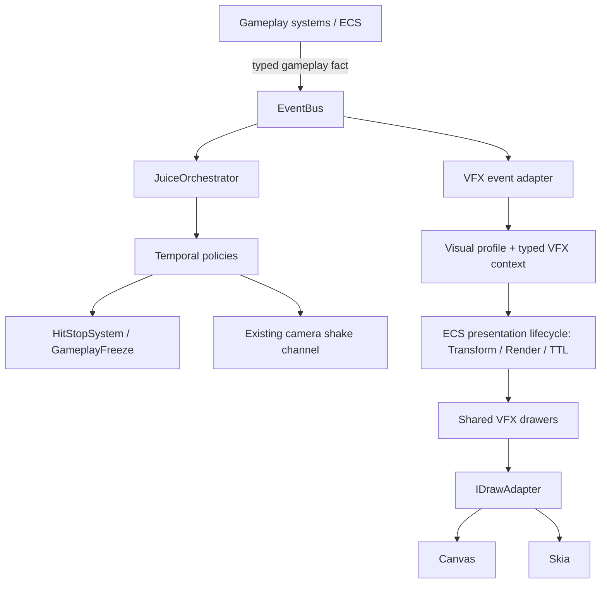

# Game Feel Architecture Contract

**Status:** Normative target architecture
**Scope:** Gameplay events, temporal coordination, visual effects and renderer presentation across ArcadeGames
**Implementation policy:** Incremental migration; this contract does not claim that the current runtime already conforms

## 1. Purpose

This document defines the ownership boundaries for Game Feel in ArcadeGames. It is the architectural reference for new work and for incremental consolidation of existing feedback paths.

The contract is intentionally built around four responsibilities:

1. **EventBus communicates gameplay facts.**
2. **JuiceOrchestrator coordinates temporal responses.**
3. **VFX owns visual representation.**
4. **Canvas and Skia present equivalent visual output.**

These are separate responsibilities, not four names for one pipeline. A gameplay fact may have multiple independent consumers. In particular, JuiceOrchestrator is not the gateway through which VFX must pass.

### 1.1 Canonical flow

The two EventBus consumer paths are parallel:

- JuiceOrchestrator decides **when and for how long** temporal feedback should act.
- VFX decides **what visual representation** a gameplay fact produces.

Neither path should invoke the other to perform its own responsibility. Canvas and Skia are alternative presentation backends for the same visual definition, not separate effect implementations.

## 2. Normative ownership contract

| Layer | Owns | Must not own |
|---|---|---|
| Gameplay / ECS | Authoritative state transitions, collision outcomes, damage, movement, entity lifecycle and gameplay meaning | Colors, primitive names, visual profiles, particle geometry, camera shake rendering |
| EventBus | Typed publication and delivery of gameplay facts; immediate/deferred dispatch according to the existing bus API | Gameplay rules, temporal policy, VFX selection, drawing or effect lifetime |
| JuiceOrchestrator | Temporal response policy: hit-stop requests, shake envelopes, priorities, cooldowns and coordination between temporal channels | Effect primitive selection, VFX profiles, visual entity creation, Render components, TTL, drawer registration or drawing |
| VFX | Mapping gameplay facts to visual descriptors, family-specific visual context, semantic profiles, effect composition and presentation entities | Damage, collision validity, forces, movement, gameplay clocks, hit-stop policy or authoritative gameplay state |
| Canvas / Skia | Backend-specific execution of the shared drawing contract | Gameplay semantics, event interpretation, per-backend effect designs or independent effect timing |
| Visual Lab | Inspection and reproducible presentation of production VFX definitions | A parallel production drawer registry, gameplay simulation or an alternative renderer implementation |

### 2.1 Gameplay systems

Gameplay systems are the sole authority for deciding that a meaningful event occurred.

A gameplay system must:

- Complete or commit the relevant gameplay transition before publishing its event.
- Publish a typed domain fact such as `combat:hit`, `combat:death`, `locomotion:slide_started` or `CollectiblePickedUp`.
- Include the semantic information consumers cannot safely recover later, such as source/target identity, impact position, direction or material, where relevant.
- Remain correct when no VFX, audio or Juice consumer is registered.

A gameplay system must not publish a renderer instruction such as `spawn pixelfx_explosion`, choose a palette, decide a TTL or call a drawer. It must not create an event solely to make a particular effect appear. Events describe things that happened in gameplay; they are not visual commands disguised as domain events.

### 2.2 EventBus

The existing typed EventBus is the communication boundary between gameplay producers and feedback consumers.

Its responsibilities are limited to:

- Typed event names and payload delivery.
- Immediate or deferred dispatch through the existing EventBus API.
- Subscription and unsubscription lifecycle.

The EventBus does not decide what an event means visually or temporally. It must not depend on JuiceOrchestrator, VFX drawers, Canvas or Skia.

Event payloads carry facts and semantic context, not presentation policy. Prefer fields such as `entity`, `sourceEntity`, `targetEntity`, `x`, `y`, `direction`, `surface` or `material`. Do not put `effectName`, `tint`, `ttl`, `shakeIntensity` or renderer-specific objects in gameplay event payloads.

Consumers must not depend on handler registration order to establish gameplay semantics. Any required temporal ordering belongs in an explicit temporal policy, not in accidental subscription order.

### 2.3 JuiceOrchestrator — temporal coordination only

JuiceOrchestrator consumes gameplay facts and resolves their temporal response. It may coordinate:

- Hit-stop duration, priority, ownership and cooldown requests.
- Screen-shake intensity and duration envelopes through the existing camera feedback channel.
- Synchronization or sequencing between supported temporal channels.
- Accessibility policy that scales or suppresses presentation-side temporal feedback, without changing authoritative gameplay outcomes.

Hit-stop continues through the existing canonical route: Juice policy requests are resolved by HitStopSystem and core GameplayFreeze. GameplayFreeze and the core scheduler remain authoritative for simulation freeze. JuiceOrchestrator must not create another freeze clock.

For rollback/resimulation, authoritative hit-stop requests must be replayed according to the established snapshot/scheduler contract. Presentation-only outputs such as duplicate shake impulses, VFX and audio must not be emitted again during replay.

JuiceOrchestrator must not:

- Select a VFX primitive or visual profile.
- Construct a VFX descriptor.
- Create an effect entity or write `Transform`, `Render` or `TTL` components.
- Register drawers or depend on `IDrawAdapter`, Canvas, Skia or PixelFX effect modules.
- Own effect progress, particle composition or visual lifetime.

The camera/presentation system remains responsible for rendering camera displacement. JuiceOrchestrator coordinates the temporal request; it does not draw the shake.

### 2.4 VFX — visual representation only

VFX consumes the same typed gameplay facts independently of JuiceOrchestrator and translates their meaning into a visual representation.

VFX owns:

- Mapping gameplay event types to effect identities and compositions.
- Typed family contexts (for example combat, traversal, interaction and temporal presentation).
- Semantic visual profiles and theme-token resolution.
- Placement and orientation derived from actual gameplay context.
- Creation of transient presentation entities through the existing ECS lifecycle.
- Procedural or sprite-backed visual composition and deterministic visual variation.

VFX must not decide whether a hit, death, pickup, landing or dash occurred. It must not change health, movement, physics, collision, gameplay RNG or simulation time. A VFX failure or missing renderer must never invalidate the gameplay event.

Transient procedural effects continue to use existing ECS presentation components such as `Transform`, `Render` and `TTL`. TTL remains the existing lifetime mechanism; this contract does not authorize a parallel particle engine, lifetime manager or scheduler.

VFX definitions must receive semantic, typed context rather than a universal untyped payload. A drawer should receive resolved presentation state and draw it; it should not query gameplay rules to decide whether an effect is valid.

VFX modules must not import runtime behavior or type definitions from JuiceOrchestrator. Shared visual identities and contracts belong to the VFX/presentation side or to a genuinely neutral contract module. This includes removing the current type-level dependency where `VFXEffectIR` imports `SharedVFXPrimitiveName` from `JuiceOrchestrator`.

### 2.5 Canvas and Skia — equivalent presentation

A visual effect has one semantic definition and one composition contract. Canvas and Skia are backends for presenting that definition.

The shared boundary remains `IDrawAdapter` from `DrawAdapter.ts`. Effect drawers should depend on the adapter contract, not on `CanvasRenderingContext2D` or Skia APIs directly.

Both backends must preserve equivalent:

- Geometry, silhouette and relative proportions.
- Coordinate space, transforms, orientation and scale.
- Layering and draw order.
- Alpha, stroke/fill intent and semantic color.
- Progress and lifetime sampling.
- Visibility and edge-case behavior for missing or expired entities.

Pixel-identical raster output is not required where backend rasterization differs. Semantic and geometric equivalence is required and must be tested with tolerances appropriate to the operation.

A backend-specific bug belongs in its adapter implementation unless the shared effect definition itself is wrong. Do not fork an effect composition to compensate for an adapter defect.

### 2.6 Visual Lab

Visual Lab is a development and review surface over the production effect definitions, profiles and drawers.

It must:

- Invoke the same production drawer functions used by games.
- Use the same `IDrawAdapter` implementations and registration contracts.
- Make a scenario reproducible through stable effect identity, profile, semantic context, seed/variant, dimensions, renderer and sampled progress/time.
- Support review at meaningful temporal samples, including start, peak and dissipation.

It must not maintain a second production effect implementation, independent timing engine or alternative renderer registry. A preview is evidence of a visual definition, not proof of a live gameplay integration.

## 3. Contracts between layers

### 3.1 Event contract

A feedback-relevant event must satisfy all of the following:

1. It names a real gameplay fact, not a desired visual.
2. It has a typed payload in the owning game's EventRegistry.
3. It is emitted at a defined point in the gameplay transition.
4. It is emitted once per authoritative occurrence, with deduplication owned by the gameplay/event producer where needed.
5. Its payload contains enough stable semantic context for consumers to react safely.
6. It does not contain visual or temporal policy.

If an effect requires information that is lost when the entity is destroyed, the producer should include the relevant immutable snapshot (for example position, direction or material) in the gameplay event. VFX must not depend on querying a destroyed or already-mutated entity.

### 3.2 Temporal response contract

Temporal response maps are separate from visual response maps.

The eventual configuration model must keep these concerns distinct:

- **Temporal response:** hit-stop, priority, cooldown and shake envelope.
- **Visual response:** effect identity, semantic family, visual profile, placement, scale and visual lifetime.

One gameplay event may have both responses, only one response, or neither. A visual effect must not be required to trigger hit-stop; hit-stop must not be required to spawn a visual effect.

### 3.3 Visual descriptor contract

A VFX descriptor should identify:

- A stable effect ID.
- A semantic family.
- A typed family context.
- A semantic visual profile.
- Optional resolved presentation placement and deterministic variation input.

The descriptor is presentation data. It cannot grant authority to alter gameplay. Its exact TypeScript shape is owned by the VFX contract and should evolve from real consumers rather than introducing a general-purpose visual scripting runtime.

### 3.4 Time domains

The implementation must distinguish:

- **Simulation time:** advances authoritative gameplay and is controlled by the ECS schedule.
- **Presentation time:** samples visual-only animation, subject to supported pause/accessibility policy.
- **Effect lifetime:** bounds the existence of a transient presentation entity; currently represented by ECS TTL.

VFX must not modify simulation delta or gameplay outcomes. Do not create a second scheduler to support effect curves or Visual Lab scrubbing. Prefer TTL-derived progress and deterministic, closed-form sampling where they satisfy the effect.

## 4. Determinism, rollback and resource ownership

- Gameplay RNG is reserved for authoritative gameplay. Presentation variation must use an explicit stable seed or deterministic derivation and must not consume gameplay RNG.
- A resimulation must not duplicate presentation entities, shake impulses or audio.
- Authoritative temporal requests such as the canonical hit-stop request must follow the established rollback policy and be replayed when required.
- Transient presentation state remains in the existing ECS lifecycle. No parallel entity manager or particle lifecycle is permitted.
- No VFX drawer may mutate gameplay components or authoritative resources.
- Presentation policy may respect accessibility settings; accessibility must not change authoritative damage, collision, movement or freeze duration.

## 5. Dependency direction

The allowed conceptual dependency direction is:

- Gameplay systems → typed EventBus contracts.
- EventBus → registered handlers, without depending on their implementations.
- JuiceOrchestrator → typed gameplay event contracts and existing core temporal/camera channels.
- VFX event adapters → typed gameplay event contracts and VFX presentation contracts.
- VFX drawers → `IDrawAdapter` and read-only presentation state.
- CanvasDrawAdapter / SkiaDrawAdapter → their respective rendering APIs.

The following dependencies are forbidden:

- Gameplay → VFX drawer, renderer or visual profile.
- EventBus → JuiceOrchestrator or VFX implementation.
- JuiceOrchestrator → VFX primitive catalog, drawer, Render/TTL entity creation or renderer.
- VFX → JuiceOrchestrator.
- Effect drawer → Canvas or Skia concrete API.
- Canvas/Skia → gameplay event registry or gameplay rules.

If a type is required by both Juice and VFX, extract a narrow neutral contract rather than importing one subsystem into the other.

## 6. Current implementation baseline and known gaps

This section records observed source structure so the target contract is not mistaken for an assertion of current compliance.

| Concern | Current source evidence | Contract gap |
|---|---|---|
| Event transport | `packages/core/src/events/EventBus.ts` exposes typed `on`, immediate/deferred dispatch; `src/games/asteroids/types/AsteroidRegistry.ts` declares `combat:hit` and `combat:death` | Retain this boundary; audit producers and feedback subscribers game by game |
| Temporal and visual orchestration | `src/games/shared/rendering/JuiceOrchestrator.ts` currently combines `JUICE_CATALOG`, `triggerEvent`, `spawnEffect` and `spawn` | Split temporal response from visual response; remove VFX spawning responsibility from JuiceOrchestrator |
| Mixed profile catalog | `JUICE_CATALOG` profiles currently contain primitive, tint, scale, TTL, hit-stop and shake fields | Separate temporal policy from visual profile mapping |
| VFX descriptor dependency | `src/games/shared/rendering/VFXEffectIR.ts` imports `SharedVFXPrimitiveName` from JuiceOrchestrator | Move the shared visual identity to the VFX/presentation domain or a neutral contract |
| ECS presentation lifecycle | `JuiceOrchestrator.spawn` currently creates entities and writes `Transform`, `Render` and `TTL` | Preserve ECS lifecycle, but move ownership of those operations to VFX |
| Rendering parity | `DrawAdapter.ts`, `PixelFxProceduralVFX.ts` and `SharedVFX.ts` provide the adapter/drawer/registration foundation | Preserve one shared composition and verify both backends |
| Asteroids death feedback | `AsteroidCollisionSystem.onRegister` subscribes to `combat:death`; `onCombatDeath` calls `spawnExplosionParticles` and `triggerEvent("asteroids", "rock:destroyed")`, and also calls `Juice.shake` directly | Known duplicate visual request and duplicated shake path; tracked in `docs/agents/vfx-ledger.md` |

### 6.1 Important current behavior in JuiceOrchestrator

The current `spawn()` implementation requests hit-stop through `requestHitStop`, applies shake through `Juice.shake`, and creates presentation entities with `Transform`, `Render` and `TTL`. Its rollback behavior intentionally replays authoritative hit-stop requests before suppressing presentation output. That distinction must be preserved while responsibilities are separated.

The current `triggerEvent()` resolves a game event through `JUICE_CATALOG` and forwards both visual and temporal parameters to `spawn()`. This is a migration seam, not the final contract.

### 6.2 Existing architecture to preserve

The separation does not authorize replacement of working infrastructure:

- Core `EventBus` and per-game typed EventRegistry.
- Core ECS entity/component lifecycle and TTL.
- `HitStopSystem` and core `GameplayFreeze` as the canonical hit-stop route.
- Existing camera shake channel and its consumers.
- `IDrawAdapter`, `CanvasDrawAdapter`, `SkiaDrawAdapter`.
- `SharedVFX` registration and production drawer modules.
- Existing sprite registry/animator for sprite-backed effects.
- Visual Lab as a consumer of production definitions.

Do not add another EventBus, scheduler, timeline runner, renderer registry, particle engine or entity manager to achieve this contract.

## 7. Incremental migration plan

Migration is sequential, evidence-based and reversible. Existing integrations continue working until an equivalent replacement is verified.

### Step 0 — Establish and audit the contract

- Treat this document as the normative ownership reference.
- Keep `docs/agents/vfx-ledger.md` as the evidence ledger for individual VFX integrations.
- Audit one effect or one system per unit of work.
- Record real event producer, subscribers, temporal response, VFX response, ECS lifecycle, Canvas/Skia registration, tests and Visual Lab scenario.
- Keep Phase 0 open until the complete inventory is reconciled and approved. Do not begin a broad runtime migration while `unknown` or `blocked` entries remain.

### Step 1 — Separate the configuration and type boundaries

- Split the current mixed `JUICE_CATALOG` responsibility into distinct temporal and visual response mappings.
- Move visual primitive/effect identities and descriptor types out of JuiceOrchestrator.
- Make JuiceOrchestrator consume gameplay facts only for temporal coordination.
- Make VFX consume the same gameplay facts independently for visual response.
- Keep the existing public behavior available during migration where needed; do not perform a big-bang rewrite.

The exact API names and subscription ownership are implementation decisions to be made against the audited call sites. Do not create a generic plugin system or universal event-to-graph engine.

### Step 2 — Migrate one real event as a pilot

Choose one event with a complete, reproducible gameplay path and migrate it end to end:

1. The gameplay producer emits one typed fact.
2. The temporal subscriber resolves only temporal feedback.
3. The VFX subscriber resolves only visual feedback.
4. The VFX runtime uses the existing ECS lifecycle.
5. The same drawer composition is registered for Canvas and Skia.
6. Focused tests prove the event-to-temporal and event-to-visual paths independently.
7. Visual Lab provides a reproducible visual scenario where the effect is significant.

Asteroids `combat:death` / `rock:destroyed` is a strong pilot candidate because its current duplicate explosion and shake paths are already documented. It is not permission to skip the Phase 0 inventory approval gate.

After the first integrated effect in a new family (traversal, interaction or environmental), stop for review before integrating a second effect in that family.

### Step 3 — Expand incrementally

- Migrate one effect or one integration slice per unit.
- Prefer real gameplay events over direct visual calls.
- Preserve game-specific behavior when it is genuinely specialized; do not force every effect into one universal implementation.
- Require measurable evidence before performance refactors.
- Keep sprite-sheet and procedural VFX inventories separate.

### Step 4 — Retire legacy paths safely

Before deleting or replacing a legacy feedback path:

- Search all producers and consumers.
- Verify event coverage and rollback semantics.
- Prove the replacement produces equivalent temporal and visual behavior.
- Add or update tests.
- Remove the legacy path only after the evidence is complete.

Do not remove a path merely because a new abstraction exists.

## 8. Definition of done for an integrated effect

An effect integration is complete only when all applicable evidence exists:

- A real gameplay transition publishes a typed EventBus fact.
- The event is not emitted solely to request a visual.
- Temporal response is owned by JuiceOrchestrator and does not select or create VFX.
- Visual response is owned by VFX and does not alter gameplay or temporal policy.
- ECS presentation lifecycle is used without a second lifetime manager.
- The production drawer is registered and behaves equivalently on Canvas and Skia.
- Focused tests cover event mapping, lifecycle, determinism and renderer registration/parity.
- Rollback/resimulation does not duplicate presentation output and preserves required authoritative temporal behavior.
- A reproducible Visual Lab or in-game scenario exists for meaningful effects.
- Typecheck, focused tests, CI/ratchet and duplication checks pass according to repository policy.

A drawer existing in source, a catalog entry, a test fixture or a Visual Lab preset alone is not proof of a complete gameplay integration.

## 9. Change control and decision rules

- A change that moves responsibility across these boundaries must update this contract or an associated decision record.
- If an implementation requires JuiceOrchestrator to create or render VFX, or VFX to request hit-stop directly, stop and resolve the ownership conflict before coding.
- If a requirement cannot be expressed with the existing EventBus, ECS lifecycle, temporal channels or draw adapter, present the smallest missing contract and its alternatives before introducing new infrastructure.
- Do not merge a pull request without explicit authorization.
- Report source evidence and actual test execution separately. A GitHub source inspection is not a local test run.

## 10. Related records

- `docs/agents/vfx-ledger.md` — per-effect VFX audit and integration evidence.
- `docs/agents/juice-consolidation-ledger.md` — temporal/legacy Juice audit history and phase status.
- `docs/audit/vfx-effects-inventory.md` — procedural and sprite-sheet effect inventory.
- `docs/audit/vfx-architecture-audit.md` — source-level VFX architecture findings.
- `docs/specs/vfx-architecture-2.0-decisions.md` — earlier design decisions; its original statement that JuiceOrchestrator remains the combined spawn/event entry point is superseded by this ownership contract.
