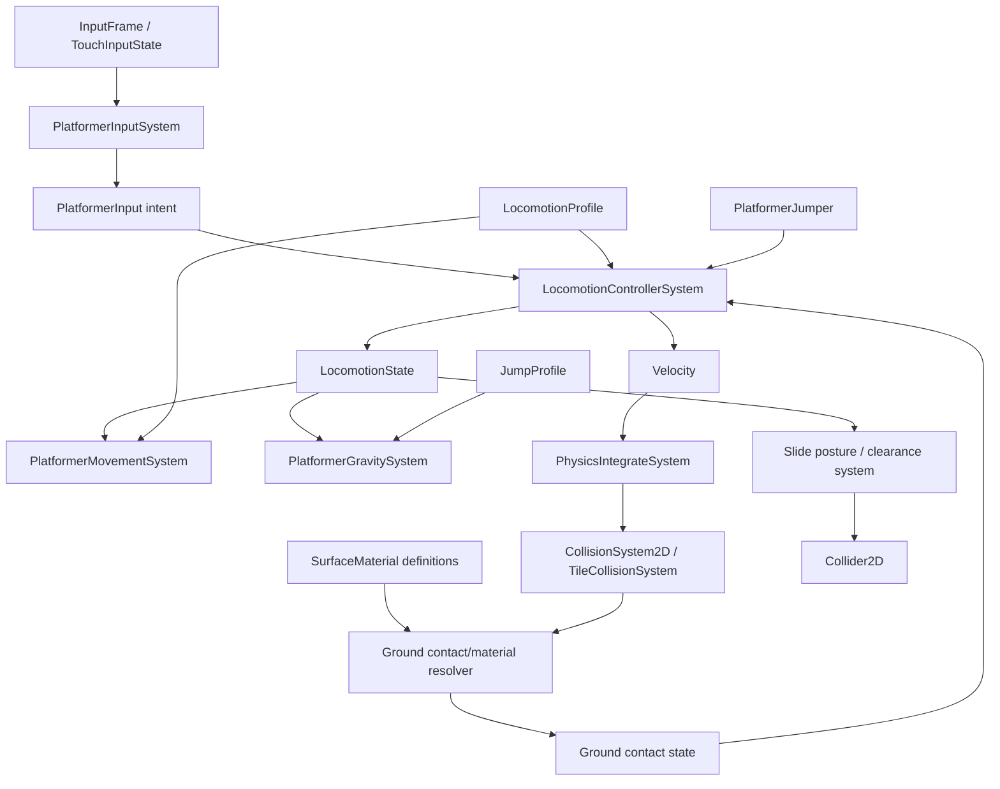

# Locomotion v1 — Design Proposal

**Status:** design baseline; implementation follows in isolated, tested increments.  
**Related audit:** [locomotion-v1-audit.md](./locomotion-v1-audit.md)

## 1. Design goals

- Extend the existing platformer movement stack; do not add a parallel controller or momentum system.
- Keep `Velocity` as the only world-space linear velocity and `PhysicsIntegrateSystem` as the position integrator.
- Store every simulation-relevant locomotion state in ECS components so snapshots and rollback restore it.
- Separate sampled input, locomotion decisions, acceleration/gravity, contact resolution and collision geometry.
- Preserve existing Platformer and Echo Runner behavior through explicit compatibility tests and opt-in profiles where necessary.

## 2. Proposed dependency graph

The diagram is conceptual. Exact system names and phase placement will be finalized only after the implementation is aligned with the existing schedule and actual collider/query APIs.

## 3. State and data contracts

### 3.1 Input intent

Retain the current `PlatformerInput` component as the sampled intent boundary. The optional `previousJumpHeld` field now stores the previous sampled jump state in ECS. `PlatformerInputSystem` derives `jumpPressed` and `jumpReleased` from it, so system recreation and generic world snapshots preserve the edge-detection state.

Add slide intent only when it can be populated by the existing keyboard/gamepad/touch mapping without storing edge history in a system-instance field. Future button edges must follow the same ECS-backed or tick-indexed-input-frame rule.

### 3.2 Locomotion state

Introduce a serializable per-entity locomotion state with a small mode enum:

- `grounded`
- `airborne`
- `sliding`

Store only non-derivable transition data: previous mode if needed for transition events, slide elapsed ticks, and explicit transition flags if a single tick requires them. Rising/falling should remain derivable from vertical velocity.

The controller owns transition policy, not position integration. It may apply a jump impulse to `Velocity`, but must not directly advance `Transform`.

### 3.3 Profiles

Prefer immutable profile data attached to the entity or referenced by a stable profile key. Do not create per-tick profile objects.

The movement profile extends the existing `PlatformerMovementConfig` semantics: run speed, ground acceleration/deceleration, air acceleration/deceleration, ground friction and air drag. Avoid imposing a global speed clamp on inherited velocity; clamp only input-driven target speed/acceleration contribution.

The jump profile extends `PlatformerGravityConfig` and `PlatformerJumper`: jump impulse, gravity multipliers, fall cap, coyote ticks and buffer ticks. Gravity remains a single authority. The current `PlatformerGravitySystem` is the natural extension point.

The slide profile contains entry speed, reduced collider dimensions, friction, acceleration/steering scale and min/max duration ticks. Standing collider restoration is conditional on a clearance query.

## 4. Responsibilities

| Unit | Owns | Must not own |
|---|---|---|
| Input sampler | Map InputFrame/touch state into normalized intent and button edges | Physical velocity, collision or timers outside ECS |
| Locomotion controller | Mode transitions, coyote/buffer consumption, jump and slide requests | Position integration, collision resolution |
| Horizontal movement | Ground/air acceleration and deceleration | Jump policy, collider geometry |
| Gravity | Vertical acceleration, variable-height gravity, fall-speed cap | Ground detection or input edge history |
| Physics integrator | Velocity-to-position integration | Input interpretation |
| Collision systems | Geometric detection and response | Gameplay mode policy |
| Contact/material resolver | Ground normal, material and surface-relative contact data | Movement input |
| Slide posture system | Collider posture change and stand-up clearance | Arbitrary positional depenetration |

## 5. Jump timing and tick semantics

Coyote and jump-buffer windows are integer tick counters. The system must define whether a configured value includes the current tick and ensure tests cover the boundary tick and first expired tick.

Recommended processing order per simulation tick:

1. Sample current input frame and derive pressed/held/released edges.
2. Consume prior tick's resolved ground contact for jump eligibility.
3. Refresh coyote availability while grounded; otherwise decrement it.
4. Capture a jump press into the buffer.
5. If grounded/coyote-eligible and buffer is active, consume both exactly once and apply the jump impulse.
6. Apply short-hop/variable-height behavior from held/released input.
7. Apply horizontal acceleration and gravity.
8. Integrate velocity.
9. Detect and resolve collision.
10. Publish the ground contact for the next tick.

This ordering deliberately uses resolved contact from the previous completed tick. Landing-buffer execution therefore occurs on the first controller tick after the landing contact is published, with deterministic one-tick semantics.

Double jump is an existing Platformer feature (`maxJumps: 2`). It must be represented as an explicit profile capability or compatibility policy, not accidentally removed as part of single-jump v1 work.

## 6. Surface and slope model

### 6.1 Material data

Existing `TileDefinition` already contains optional `friction`, `bounce` and a limited `kind` classification (`normal | ice | spike | bounce`). Evolve this metadata toward a stable material key, rather than hardcoding Stone/Ice/Mud/Sand/Metal inside the controller.

Material definitions should be centralized and immutable. `grip`, `restitution`, `slopeAccelerationScale` and `canSlide` belong to the surface material contract. The controller receives resolved contact data, not tile IDs or material-specific branches.

### 6.2 Ground contact

Grounded contact data needs a normalized normal, material key and (when applicable) surface velocity. Generic collision manifolds already expose normal vectors; tile collision currently does not expose a slope normal.

### 6.3 Slope support

A coefficient applied to the existing axis-aligned tile collision system does not create slope physics. True slopes require a collision representation that supplies a stable surface normal and a resolution path that constrains the body to that surface. The smallest viable extension is a tile-shape/surface segment descriptor plus a tile contact result containing point, normal and material key.

Until that extension is implemented and tested, the system must not claim slope support. Do not infer a normal from the player's velocity or snap the player to an arbitrary height.

For a valid contact normal `n`, gravity tangent is:

`g_t = g - dot(g, n) * n`

Tangential friction opposes relative tangential velocity. Any surface velocity is subtracted before friction/projection and added back when reconstructing world velocity.

## 7. Velocity transfer policy

- World velocity is stored in `Velocity.vx/vy`.
- Surface-relative velocity is a derived value: `v_relative = v_world - v_surface`.
- Contact normal velocity is `dot(v_relative, n)`; resolve it through the existing collision response/contact solver.
- Tangential velocity is `v_t = v_relative - dot(v_relative, n) * n`.
- Jump applies an explicit impulse along the configured jump axis while preserving tangential velocity. It must not zero `vx` or replace the entire velocity vector.
- Sliding changes acceleration/friction response, not the canonical velocity store.
- Landing projects/resolves the normal component through collision resolution; controller code must not reset horizontal momentum.

## 8. Collider posture and clearance

Sliding changes the existing collider shape dimensions. Returning to standing requires a non-mutating overlap/shape query at the standing dimensions and current transform. If the standing shape overlaps solid geometry, remain in sliding posture (or a clearly defined crouched state); never move the entity through a wall or ceiling to force the transition.

The query must use the same collision geometry and filtering rules as the authoritative collision path. A renderer-only or approximate screen-space test is insufficient.

## 9. Schedule policy

The inspected Schedule sorts priorities descending. Therefore priority `-10` executes after priority `0` within Simulation, matching the existing registry comment for `PhysicsIntegrateSystem`.

Keep input in Input phase. Keep controller/movement/gravity in Simulation before integration. Keep collision detection/resolution in Collision. Since the current collision result is published after Simulation, the controller consumes the previous completed tick's ground contact. Do not move collision into Simulation solely to make the controller convenient.

If a post-collision contact finalizer is needed, register it at a deliberate Collision priority after all collision solvers. Verify the relative ordering of `CollisionSystem2D` and `TileCollisionSystem` before adding it.

## 10. Snapshot and deterministic state

All counters, mode, jump-held edge history, material key, slide elapsed ticks and posture flags that influence the next tick must live in ECS components/resources included in snapshots. System instances remain stateless across ticks.

Use fixed-timestep `deltaTime` for integration only. Gameplay windows use integer ticks. Avoid wall-clock reads and non-seeded randomness.

## 11. Compatibility and migration

- Preserve the existing `PlatformerMovementConfig`, `PlatformerGravityConfig`, `PlatformerJumper` and `PlatformerGroundState` public contracts where practical; add optional fields first, migrate constructors/builders, then tighten types.
- Platformer currently enables two jumps. Preserve this through a legacy profile until the game explicitly opts into single jump.
- Echo Runner shares common registration; test its current movement and replay behavior after every shared-system change.
- Do not register a second copy of movement/gravity/coyote systems alongside the existing systems.

## 12. Implementation gates

1. [x] Confirm generic snapshot serialization of ECS component fields; verify builder collider type before posture work.
2. [x] Move jump edge history into ECS-backed deterministic data; jump execution is still split and consolidation remains pending.
3. Add movement profile/controller state with focused unit tests.
4. Extend gravity and tick timers with boundary tests.
5. Add slide posture/clearance query; do not ship if stand-up overlap is unresolved.
6. Add surface material lookup and a real slope-capable contact geometry path.
7. Add deterministic integration/replay tests and Locomotion Lab.
