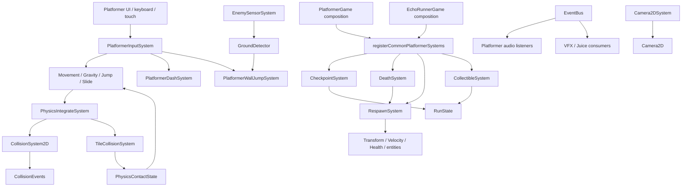

# Auditoría de hipótesis — Platformer / Echo Runner

**Fecha:** 2026-11-24  
**Repositorio:** `xavirodriguez/ArcadeGames`  
**Commit auditado:** `9104890449f114565a43e63bd5b8a90c167f139b`  
**Rama de auditoría:** `audit/platformer-hypotheses-2026-11-24`  
**Método:** lectura de archivos en el commit fijado, búsquedas de código, revisión de tests y documentos arquitectónicos. No se modificó código de producción.

> **Alcance y limitación material:** esta revisión se hizo mediante lectura remota del repositorio. No hubo checkout local ni acceso al entorno de ejecución del workspace. Por tanto, no se pudo ejecutar `pnpm run ci`, inspeccionar el `git status` de un checkout, ni afirmar que la suite local esté verde. El único check publicado que se pudo consultar para el commit fue un status de Vercel en `success`; no representa el resultado de `pnpm run ci` ni una ejecución de Jest. Las hipótesis que requieren inventarios exhaustivos quedan expresamente como PARCIAL o NO VERIFICABLE.

## 1. Resumen ejecutivo

| ID | Afirmación (resumen) | Veredicto | Confianza | Esfuerzo | Riesgo |
|---|---|---|---|---|---|
| A1 | Manifolds genéricos no alimentan PhysicsContactState | CONFIRMADA | alta | M | alto |
| A2 | Wall-jump usa fallback de input; GroundDetector es sensing de enemigos | CONFIRMADA | alta | S | medio |
| A3 | Dash pisa velocity y no hay impulsos genéricos | PARCIAL | media | M | alto |
| A4 | Slope es un segmento lineal por tile | CONFIRMADA | alta | M | medio |
| A5 | Jugador conserva Collider legacy y Collider2D | CONFIRMADA | alta | M | alto |
| A6 | Campaign tiene 3 templates; no hay tooling y Echo Runner no comparte pipeline | PARCIAL | media | M | medio |
| A7 | Brake simulado pero no enviado por UI; input ad-hoc | PARCIAL | alta | M | medio |
| A8 | Tests de campaign solo estructurales; no hay integración/completabilidad | REFUTADA | alta | M | medio |
| A9 | Fricción con gravedad fija y sin perfiles | REFUTADA | alta | M | medio |
| A10 | Snapshots/hashes deterministas existen y cubren locomotion | CONFIRMADA | alta | M | alto |
| B1 | No existe CheckpointSystem; respawn disperso | REFUTADA | alta | S | alto |
| B2 | Daño específico y sin HazardSystem genérico | PARCIAL | media | M | alto |
| B3 | Cámara sin deadzone/lookahead/clamp | REFUTADA | alta | S | medio |
| B4 | EnemySensor/GroundDetector duplican sensing del jugador | PARCIAL | alta | M | medio |
| B5 | No hay EventBus tipado para platformer | PARCIAL | alta | M | alto |
| B6 | Platformer no emite eventos sonoros desde simulación | REFUTADA | alta | S | medio |
| B7 | No hay contrato de progreso por nivel | PARCIAL | media | M | medio |
| B8 | No hay pickups/coleccionables en platformer | REFUTADA | alta | S | medio |
| B9 | No hay overlays locomotion en platformer | NO VERIFICABLE | baja | S | bajo |
| B10 | JSON sin abilities/ruleset y habilidades hardcodeadas | PARCIAL | media | M | medio |
| C1 | Snapshot/hash incluye locomotion; cambio A1 afectaría replay baselines | PARCIAL | media | M | alto |
| C2 | Dependencias knockback/impulses, sensing compartido y snapshots | PARCIAL | media | M | alto |
| C3 | Hazard/checkpoint/cámara/collectible deben ir en Core o gameplay-kit | NO VERIFICABLE | baja | L | alto |
| C4 | Solapes con trabajo en curso | CONFIRMADA | alta | M | medio |

**Lectura ejecutiva:** varias premisas centrales ya están implementadas: perfiles de locomoción, materiales, slope lineal, snapshots/replay de locomotion, CheckpointSystem/RespawnSystem, cámara con lookahead/deadzone/clamping, coleccionables y emisión de cues por EventBus. Los gaps reales más claros son la desconexión entre los manifolds AABB genéricos y PhysicsContactState, el fallback de wall sensing del jugador, la implementación imperativa del dash, y el input/UI incompleto para brake y gamepad. No se debe iniciar una abstracción transversal antes de cerrar el inventario de consumidores y confirmar qué sistemas comunes ya están registrados.

## 2. Baseline y orientación

### 2.1 Baseline

- Commit de referencia: `9104890449f114565a43e63bd5b8a90c167f139b`.
- La API de contenido de GitHub sirvió los archivos del commit anterior para las rutas consultadas.
- Status consultado: check de Vercel `success`. No se encontró una ejecución de workflow asociada a este SHA a través del endpoint de runs disponible.
- `pnpm run ci`: **NO EJECUTADO**. No se dispuso de checkout ni de shell dentro del workspace.
- Número de tests ejecutados: **NO VERIFICABLE**. La cantidad de tests existentes tampoco se contó exhaustivamente.
- Rama local y `git status`: **NO VERIFICABLE**. Se creó una rama remota de auditoría desde el SHA auditado; no equivale a comprobar el estado de un checkout local.
- CI sigue igual: **NO VERIFICABLE** sin ejecutar el comando antes/después. No se modificó ningún workflow ni archivo de CI.

### 2.2 Orientación arquitectónica

`AGENTS.md` identifica el monorepo y sus límites: `packages/core` es el ECS/physics/snapshot runtime; `packages/gameplay-kit` contiene sistemas de gameplay reutilizables; el root Expo app y `src/games` ensamblan los juegos. También exige inspeccionar implementación, callers, tests y ledgers antes de cambiar contratos (`AGENTS.md:1-24`; `AGENTS.md:29-49`). El operating contract insiste en distinguir implementación, tests escritos y tests realmente ejecutados (`docs/agents/OPERATING_CONTRACT.md:1-28`; `docs/agents/OPERATING_CONTRACT.md:42-63`).

Mapa confirmado en los archivos consultados:

- Platformer: `src/games/platformer/PlatformerGame.ts`, sistemas específicos bajo `src/games/platformer/systems/`, niveles bajo `src/games/platformer/levels/`.
- Echo Runner: `src/games/echorunner/EchoRunnerGame.ts`, `src/games/echorunner/types/`, `src/games/echorunner/levels/`.
- ECS/physics/snapshots/camera: `packages/core/src/ecs/`, `packages/core/src/physics/`, `packages/core/src/snapshots/`, `packages/core/src/rendering/Camera2D.ts`.
- Sistemas comunes de platformer: `packages/gameplay-kit/src/arcade/helpers/platformerSystemRegistry.ts`.
- Inputs UI: `src/app/platformer/index.tsx`, sistema normalizador `src/games/shared/systems/PlatformerInputSystem.ts`.
- Persistencia de campaña: existe `src/hooks/campaign/useCampaignPersistence.ts`; no se completó el trazado de su integración específica con Platformer.
- Audio settings: `src/services/AudioSettingsService.ts`; Platformer crea `WebAudioPlayer` y consume eventos `PlaySFX` / `CollectiblePickedUp` en `PlatformerGame.ts).

### 2.3 Solape con Game Feel

El contrato `docs/architecture/GAME_FEEL_ARCHITECTURE.md` es explícitamente una arquitectura objetivo, no prueba de conformidad runtime. Separa gameplay facts, EventBus, coordinación temporal, PresentationGateway, VFX, audio y backends Canvas/Skia (`docs/architecture/GAME_FEEL_ARCHITECTURE.md:1-33`). El roadmap v2 dice que Gate 0 sigue abierto y prohíbe iniciar un piloto runtime antes de completarlo (`docs/roadmaps/game-feel-architecture-v2.md:1-35`). Esto solapa B5/B6 y la emisión de feedback de A3/B2; no es un roadmap para cámara ni para física de locomoción. No asumir que el contrato normativo ya está implementado.

## 3. Hipótesis A — Simulación

### A1. Manifolds genéricos y PhysicsContactState

**Veredicto: CONFIRMADA.**

- `CollisionSystem2D` calcula `NarrowPhase.test`, notifica callbacks y actualiza `CollisionEvents`; el manifold incluye normales, profundidad y puntos (`packages/core/src/physics/collision/CollisionSystems.ts:230-260`, `:302-322`). No se observa una escritura de `PhysicsContactState` en ese flujo.
- `TileCollisionSystem` limpia y actualiza el estado de contacto, selecciona `groundContact` y actualiza `isGrounded` (`packages/core/src/physics/systems/TileCollisionSystem.ts:92-106`, `:412-421`).
- `PhysicsContact` contiene `entity`, `point`, `normal`, `separation`, `materialId`, `surfaceVelocity` y `material`; `PhysicsContactState` contiene `contacts`, `groundContact` e `isGrounded` (`packages/core/src/ecs/CoreComponents.ts:620-652`).
- Los contactos de plataformas móviles también se agregan por el camino especializado de locomotion; no son manifolds genéricos de CollisionSystem2D (`packages/core/src/physics/systems/TileCollisionSystem.ts:166-173`; ADR-005, `docs/specs/adr-005-moving-platform-support-velocity.md`).

**Búsquedas negativas / contraste:** `PhysicsContactState`; `CollisionSystem2D manifold`; `CollisionEvents normalX normalY`. La búsqueda encuentra el manifold genérico y el estado de contacto como caminos separados. No se hizo un análisis exhaustivo de cada callback registrado por juegos terceros.

**Impacto:** si se decide unificar ambos streams, hay que especificar orden de resolución, semántica de normales, triggers, materiales y deduplicación. No conectar directamente todos los manifolds sin revisar si son contactos de locomoción o colisiones de combate.

### A2. Wall jump y GroundDetector

**Veredicto: CONFIRMADA.**

- El query del wall-jump exige `PlatformerInput`, `WallJumpUnlocked`, `PlatformerGroundState`, `Velocity` y `PlatformerJumper`; no exige `GroundDetector` (`src/games/platformer/systems/PlatformerWallJumpSystem.ts:12`).
- Lee `GroundDetector` opcionalmente y cae a `input.moveDir !== 0` cuando falta (`src/games/platformer/systems/PlatformerWallJumpSystem.ts:18-25`).
- `EnemySensorSystem` describe su responsabilidad como actualización de sensores de enemigos y detectores de suelo; su implementación itera `world.query("GroundDetector", "Transform")` (`packages/core/src/systems/EnemySensorSystem.ts:5-12`, `:65-70`). El cálculo de pared y suelo se hace con el offset del detector y tilemap (`:91-125`).
- El builder común de jugador adjunta `PhysicsContactState` y los componentes de locomotion, pero no aparece `GroundDetector` en el setup consultado (`src/games/shared/componentBuilders.ts:155-206`). El blueprint del jugador Platformer registra `PlatformerInput`, DashUnlocked y WallJumpUnlocked, sin añadir GroundDetector en el fragmento inspeccionado (`src/games/platformer/PlatformerGame.ts:245-325`).

**Búsquedas negativas:** `GroundDetector EnemySensorSystem`; `wall sensor PlayerSensor GroundDetector Platformer player`; inspección del blueprint Platformer y del setup común. Estas búsquedas no sustituyen el inventario de todos los blueprints de enemigos.

**Impacto:** jugador y enemigos no consumen un stream de sensing común. Antes de crear un sensor genérico, decidir si el jugador debe consultar contactos laterales del solver o si requiere un sensor geométrico independiente.

### A3. Dash, impulsos y escrituras de Velocity

**Veredicto: PARCIAL.**

- Dash escribe `vel.vx` al iniciar y mientras dura el dash; la duración se reduce con `tickTimer`. No se ve escritura de `vel.vy` en el fragmento buscado (`src/games/platformer/systems/PlatformerDashSystem.ts:32-46`). El sistema no consulta contacto/material/slope para calcular el dash.
- Wall-jump también asigna directamente `vel.vx` y `vel.vy` (`src/games/platformer/systems/PlatformerWallJumpSystem.ts:34-40`).
- TileCollisionSystem modifica velocity durante resolución de slope y contacto, incluyendo proyección tangencial y fricción (`packages/core/src/physics/systems/TileCollisionSystem.ts:368-392`).
- RespawnSystem pone ambas componentes de velocity a cero (`packages/core/src/systems/RespawnSystem.ts:107-113`).
- PhysicsIntegrateSystem, PlatformerMovementSystem, PlatformerGravitySystem, PlatformerJumpSystem, KineticAccumulatorSystem y sistemas específicos de otros juegos también participan en la actualización de velocidad. **No se ha cerrado un inventario exhaustivo de todos los escritores** ni una matriz fiable de si cada uno respeta materiales/slopes.

**Búsquedas ejecutadas:** `PlatformerDashSystem`; `Velocity vx vy mutableComponent all systems`; `VelocityComponent getMutableComponent Velocity`. El índice de código no permite demostrar exhaustividad de una búsqueda global.

**Corrección:** “Dash sobrescribe velocity cada frame” es demasiado amplio: sobrescribe `vx` durante el periodo activo, no se ha observado que sobrescriba `vy`. “No existe sistema genérico de impulsos” queda NO VERIFICABLE con el inventario actual; existen mecanismos de movimiento, gravedad, jump, carry y acumulación cinética, pero no se demostró que sean una API genérica de impulsos.

**Impacto:** antes de implementar knockback, definir contrato de impulso (aditivo, reemplazo, clamp, prioridad, duración, soporte velocity y rollback). No convertir el dash a impulso sin pruebas de equivalencia de gameplay.

### A4. Geometría de slopes

**Veredicto: CONFIRMADA (para el contrato TileDefinition inspeccionado).**

- `TileSlopeDefinition` contiene exactamente `start` y `end`, coordenadas locales y opciones de walkable angle/snap distance (`packages/core/src/ecs/CoreComponents.ts:654-665`).
- `TileDefinition.slope` referencia una `TileSlopeDefinition` (`packages/core/src/ecs/CoreComponents.ts:667-681`).
- ADR-004 describe la superficie como un segmento lineal superior por tile y el solver como resolución de línea/tangente (`docs/specs/adr-004-locomotion-slopes-and-slide-posture.md`, sección Decisions).

**Búsquedas negativas:** `TileSlopeDefinition`; `polygon slope collision`; `curved slope multi segment tile slope`. Los resultados remiten al segmento lineal/ADR; no se realizó un rastreo completo de geometrías de colisión fuera del tilemap.

**Impacto:** polígonos, curvas o múltiples segmentos requieren un contrato distinto; no deben introducirse como campos implícitos en el actual slope.

### A5. Collider legacy y Collider2D

**Veredicto: CONFIRMADA en el jugador Platformer; inventario de todos los consumidores PARCIAL.**

- El blueprint del jugador usa `withCollider` con Box 20×30 y después añade `Collider2D` AABB halfWidth 10 / halfHeight 15 (`src/games/platformer/PlatformerGame.ts:245-298`). Coinciden dimensionalmente en ese blueprint.
- El comentario explícito dice que se conserva Collider como contrato de compatibilidad mientras PlatformCarrySystem consume Collider2D (`src/games/platformer/PlatformerGame.ts:290-292`).
- CollisionSystem2D adapta ambos tipos y los incluye en sus queries (`packages/core/src/physics/collision/CollisionSystems.ts:46-68`, `:177-189`).
- TileCollisionSystem puede leer Collider2D o Collider (`packages/core/src/physics/systems/TileCollisionSystem.ts:123-153`).
- Echo Runner usa `withCollider2D` en su jugador, según su blueprint (`src/games/echorunner/EchoRunnerGame.ts`, setup de player); no se ha demostrado que use Collider legacy como el Platformer.

**Búsquedas negativas:** `Collider withCollider PlatformerGame EchoRunnerGame`; `Collider2D Platformer player blueprint`; revisión de adaptadores en CollisionSystem2D y TileCollisionSystem.

**Corrección:** no se observa un sistema de sincronización continua de dos colliders: se inicializan por separado con dimensiones equivalentes. Eso es duplicación de contrato/configuración, no prueba de sincronización automática.

**Impacto:** retirar Collider requiere migrar todos los consumidores legacy, no solo el solver de locomotion. Mantener una sola fuente dimensional o un adaptador explícito.

### A6. Campaign y Echo Runner

**Veredicto: PARCIAL.**

- `locomotion-campaign.json` se consume desde PlatformerGame y se usa cuando `gameOptions.levelSet === "locomotion"` (`src/games/platformer/PlatformerGame.ts:24-25`, `:88-92`).
- El test valida tres IDs de template y su stitching con `SegmentGenerator.generatePlan`; exige coincidencia de entry/exit en el punto de unión (`src/games/platformer/__tests__/LocomotionCampaign.test.ts:1-10`, `:37-59`). No es evidencia de un editor/generador visual.
- Echo Runner usa `PlatformerArcadeGame`, `registerCommonPlatformerSystems` y un nivel propio `locomotion-lab.json` (`src/games/echorunner/EchoRunnerGame.ts:68-74`; `src/games/echorunner/LocomotionLab.ts`).

**Búsquedas negativas:** `locomotion-campaign.json`; `SegmentGenerator validateSegmentTemplates`; `level editor platformer campaign generator`. No se verificó la ausencia de herramientas externas/editoriales.

**Corrección:** Echo Runner comparte sistemas/pipeline de simulación común, pero no está demostrado que comparta el mismo campaign JSON/gramática. La afirmación “no hay validador” queda refutada por el uso de `validateSegmentTemplates` en tests; “no hay editor” no es verificable con el índice.

**Impacto:** distinguir pipeline de contenido (datos/gramática) del pipeline de simulación compartido.

### A7. Brake e input bindings

**Veredicto: PARCIAL.**

| Acción | Simulación / componente | Teclado Platformer | Touch Platformer | Gamepad |
|---|---|---|---|---|
| moveLeft | Sí: moveDir / input normalizado | A / ← | joystick / botón de dirección | NO VERIFICABLE |
| moveRight | Sí | D / → | joystick / botón de dirección | NO VERIFICABLE |
| jump | Sí: jumpPressed/jumpHeld | W / ↑ / Space | botón JUMP | NO VERIFICABLE |
| dash | Sí: DashUnlocked + PlatformerDashSystem | Shift / K | botón DASH | NO VERIFICABLE |
| slide | Sí: slideHeld | S / ↓ | botón SLIDE | NO VERIFICABLE |
| brake | Sí: brake / brakeActionHeld / brakeTouchHeld | No enviado por handler de teclado inspeccionado | TouchInputState lee botón brake, pero la pantalla no muestra botón BRAKE | NO VERIFICABLE |
| wallJump | Acción derivada de jump + WallJumpUnlocked, no acción de input independiente | Usa binding jump | Usa botón JUMP | NO VERIFICABLE |

- La interfaz PlatformerInput incluye `brake?` (`src/games/platformer/PlatformerGame.ts:56-64`).
- PlatformerInputSystem calcula brake a partir de `brakeActionHeld` o touchState brake (`src/games/shared/systems/PlatformerInputSystem.ts:22-38`).
- La pantalla envía moveLeft/moveRight/jump/dash/slide, pero el objeto pasado a `setInputState` no incluye brake (`src/app/platformer/index.tsx:90-102`). Los controles visibles incluyen dash, slide y jump (`:248-292`).
- No se localizó binding gamepad en la pantalla de Platformer. No equivale a probar que no exista una capa genérica de gamepad.

**Búsquedas:** `Platformer brakeActionHeld`; `Platformer keyboard gamepad input actions`; inspección directa de UI e InputSystem.

**Impacto:** añadir brake a la UI exige decidir interacción sostenida y añadir prueba por fuente; no es solo exponer un booleano.

### A8. Tests y completabilidad

**Veredicto: REFUTADA en la afirmación absoluta; PARCIAL en la cobertura de completabilidad.**

- `LocomotionCampaign.test.ts` valida estructura, tiles, materiales y stitching de templates; no instancia el juego (`src/games/platformer/__tests__/LocomotionCampaign.test.ts:1-59`).
- `PlatformerGame.test.ts` contiene pruebas de cadena input→velocity→transform→camera, dash/double jump, materialización por `game.init()` y recogida de collectibles (`src/games/platformer/__tests__/PlatformerGame.test.ts:16-89`, `:116-135`, `:309-315`).
- `LocomotionIntegrationScenarios.test.ts` ejecuta escenarios de aceleración/frenado, slopes, materiales, bounce, one-way, slide y moving platforms (`packages/core/tests/LocomotionIntegrationScenarios.test.ts:24-45`, `:169-195`, `:195-315`, `:351-439`).
- `LocomotionDeterminismReplay.test.ts` construye una simulación con snapshots, restore y hashes (`packages/core/tests/LocomotionDeterminismReplay.test.ts:1-28`).

**Clasificación parcial localizada:**

| Suite | Tipo | Qué cubre |
|---|---|---|
| `src/games/platformer/__tests__/LocomotionCampaign.test.ts` | Unit / datos | templates, tiles, seams |
| `src/games/platformer/__tests__/PlatformerGame.test.ts` | Integración | init real, cadena de simulación, dash, collectibles |
| `packages/core/tests/LocomotionIntegrationScenarios.test.ts` | Integración de sistemas | secuencias locomotion |
| `packages/core/tests/LocomotionDeterminismReplay.test.ts` | Replay / determinismo | snapshot/restore/hash |
| `packages/core/tests/PlatformerSystems.test.ts` | Unit / integración de sistemas | movement, collision, jump, camera, spikes |

**Impacto:** sí existe más que el test de campaign. No se encontró evidencia suficiente de un E2E de usuario que pruebe completabilidad de todos los templates. El siguiente test valioso es un playthrough determinista con condiciones de salida, no duplicar tests de seams.

### A9. Fricción, gravedad y LocomotionProfile

**Veredicto: REFUTADA.**

- `PhysicsMaterial` define coeficientes estáticos/dinámicos, restitución, traction y conveyor velocity (`packages/core/src/ecs/CoreComponents.ts:600-616`).
- El slope solver toma `fallGravity` de `PlatformerGravityConfig` y usa 980 solo como fallback (`packages/core/src/physics/systems/TileCollisionSystem.ts:380-384`).
- `LocomotionProfile` está declarado en Core y hay presets responsive/momentum/heavy (`packages/core/src/ecs/CoreComponents.ts:780-849`; `packages/core/src/physics/LocomotionProfiles.ts:1-100`).
- Los presets de material normal/ice/mud/elastic/conveyor están centralizados en Core (`packages/core/src/physics/PhysicsMaterials.ts:1-13`).
- Platformer configura el jugador con el preset momentum y aplica overrides de configuración (`src/games/platformer/PlatformerGame.ts:266-288`).

**Búsquedas:** `LocomotionProfile`; `PhysicsMaterial PHYSICS_MATERIAL_PRESETS`; `TileCollisionSystem fallGravity`.

**Corrección:** 980 no es una conversión universal de todos los coeficientes de fricción; es fallback gravitatorio para el cálculo de límites de fricción del slope. El perfil ya existe y se aplica en Platformer. Los presets son compartidos, pero eso no demuestra que todos los juegos deban usar el mismo perfil.

**Impacto:** no crear LocomotionProfile desde cero. Auditar cobertura de perfiles en juegos y distinguir tuning del jugador de material del mundo.

### A10. Snapshots, replay y hashes

**Veredicto: CONFIRMADA para infraestructura y locomotion; uso en producción no probado.**

- Core expone serializer/restore AoS y SoA y hash FNV-1a (`packages/core/src/runtime/BaseGame.ts:1-20`; `packages/core/src/snapshots/SnapshotSerializer.ts:45-87`; `packages/core/src/snapshots/SnapshotHash.ts:49-96`, `:106-140`).
- Hash incluye metadata, estado de recursos registrados y componentes serializables (`packages/core/src/snapshots/SnapshotHash.ts:17-35`, `:143-156`).
- Test dedicado de locomotion verifica replay determinista, restore mid-jump/mid-slide y hashes (`packages/core/tests/LocomotionDeterminismReplay.test.ts:1-28`; documento de resultados `docs/architecture/locomotion-v1-testing.md`).
- Los contactos y posture son componentes ECS, por lo que pueden serializarse si no están excluidos; la prueba locomotion cubre posture, timers y hashes. No se verificó en esta revisión el detalle de cada política de exclusión.

**Búsquedas:** `SnapshotRestore SnapshotHash`; `LocomotionDeterminismReplay.test.ts`; `SnapshotSerializer snapshotResourceKeys`.

**Impacto:** no introducir estado mutable oculto en sistemas; comprobar exclusiones y registro de recursos antes de añadir estado de checkpoint/respawn.

## 4. Hipótesis B — Juego

### B1. Checkpoint y respawn

**Veredicto: REFUTADA.**

- Existe `CheckpointSystem`, que detecta overlap con `RespawnPoint`, muta `RunState.activeCheckpoint` y emite `CheckpointActivated` (`packages/core/src/systems/CheckpointSystem.ts:8-45`).
- Existe `RespawnSystem`, que selecciona checkpoint activo o PlayerStartPoint, reconstruye entidades Respawnable, reposiciona al jugador, restablece velocity/health y emite `PlayerRespawned` (`packages/core/src/systems/RespawnSystem.ts:12-49`, `:80-133`).
- `registerCommonPlatformerSystems` registra CheckpointSystem, DeathSystem y RespawnSystem (`packages/gameplay-kit/src/arcade/helpers/platformerSystemRegistry.ts:61-65`); PlatformerGame llama a ese registro (`src/games/platformer/PlatformerGame.ts:343-349`).

**Búsquedas:** `CheckpointSystem RespawnSystem`; `activeCheckpoint RespawnPoint`; `checkpoint respawn PlatformerGame`.

**Corrección:** el flujo no está disperso enteramente en PlatformerGame; el ciclo está en Core y se activa mediante el registro común. El nivel base puede definir contenido etiquetado checkpoint, pero la prueba del contrato real requiere localizar su blueprint y su componente RespawnPoint en ese nivel.

**Impacto:** no crear otro CheckpointSystem. Revisar primero si level-01 produce RespawnPoint y si el sistema común está recibiendo los eventos de overlap esperados.

### B2. Daño, hazards e invulnerabilidad

**Veredicto: PARCIAL.**

- PlatformerDamageSystem es un adaptador específico que llama a `updatePlayerInvulnerabilityAndContactDamage` de gameplay-kit con distancia, duración, daño y cue configurados (`src/games/platformer/systems/PlatformerDamageSystem.ts:1-35`).
- TileCollisionSystem gestiona daño por spikes y emite `spike:hit` (`packages/core/src/physics/systems/TileCollisionSystem.ts:533-543`).
- Echo Runner registra EchoRunnerDamageSystem y EchoRunnerDeathZoneSystem en lugar de PlatformerDamageSystem (`src/games/echorunner/EchoRunnerGame.ts:440-457`).
- No se completó el inventario de componentes de knockback/invulnerability ni la comparación línea a línea de todos los juegos que usan el helper compartido.

**Búsquedas:** `PlatformerDamageSystem`; `updatePlayerInvulnerabilityAndContactDamage`; `HazardSystem knockback invulnerability`.

**Impacto:** existe reutilización de parte del daño; no se justifica todavía un HazardSystem universal. Separar daño de contacto, hazard de tile, death zone y knockback como políticas distintas.

### B3. Cámara

**Veredicto: REFUTADA.**

- Camera2DSystem implementa lookahead horizontal según velocidad, deadzone vertical, smoothing exponencial y boundary clamping (`packages/core/src/rendering/Camera2D.ts:44-46`, `:82-117`, `:137-160`).
- Platformer crea cámara con lookAheadX 40, smoothing X/Y 3.5 y verticalDeadzone 45 (`src/games/platformer/PlatformerGame.ts:395-400`).
- El builder ofrece opciones de cámara para juegos (`src/games/shared/componentBuilders.ts:355-395`).

**Búsquedas:** `Camera2DSystem follow target deadzone lookAhead clamp`; `Camera2D lookAheadX verticalDeadzone`; lectura de configuración Platformer.

**Corrección:** la cámara no es seguimiento directo. Ya hay sistema Core reutilizable y está cubierto por el roadmap general de presentación/Game Feel solo en lo relativo a canales de feedback/shake; no se debe atribuirle el desarrollo del seguimiento, deadzone o clamping de cámara.

**Impacto:** no implementar una segunda cámara. Auditar presets/tuning y si la cámara de Platformer necesita deadzone horizontal/lookahead configurable.

### B4. EnemySensor y jugador

**Veredicto: PARCIAL.**

- EnemySensorSystem actualiza PlayerSensor y GroundDetector de entidades que llevan esos componentes; el GroundDetector consulta tilemap para pared y suelo (`packages/core/src/systems/EnemySensorSystem.ts:5-12`, `:65-125`).
- WallJumpSystem lee GroundDetector opcional, pero su fallback es la dirección de input, no una consulta al solver (`src/games/platformer/systems/PlatformerWallJumpSystem.ts:18-25`).
- PhysicsContactState ya aporta contactos con normales y materiales (`packages/core/src/ecs/CoreComponents.ts:620-652`), pero su productor es TileCollisionSystem; no se ha probado que incluya contactos laterales del jugador en todos los casos.

**Búsquedas:** `GroundDetector EnemySensorSystem`; `wall sensor PlayerSensor GroundDetector Platformer player`; inspección de WallJumpSystem y del builder de movimiento.

**Impacto:** hay solape conceptual (detección de superficie) pero no un mismo stream de datos. No afirmar que B4 y A2 ya comparten el contact stream.

### B5. EventBus y comunicación

**Veredicto: PARCIAL.**

- BaseGame construye y mantiene EventBus genérico asociado a EventRegistry (`packages/core/src/runtime/BaseGame.ts:1-20`; `packages/core/src/events/EventBus.ts`).
- PlatformerGame obtiene el bus, se suscribe a `level:completed`, `PlaySFX`, `CollectiblePickedUp`, `PlayerDied` y eventos locomotion (`src/games/platformer/PlatformerGame.ts:144-185`).
- La comunicación de checkpoint/death/respawn/collectible usa eventos diferidos desde Core (`packages/core/src/systems/CheckpointSystem.ts:44-45`; `packages/core/src/systems/DeathSystem.ts:59-60`; `packages/core/src/systems/RespawnSystem.ts:131-133`; `packages/core/src/systems/CollectibleSystem.ts:61-62)).
- Platformer tipa su juego con el EventRegistry base, no se localizó un registry de eventos dedicado en su definición. El sistema también comparte estado ECS/RunState y mutaciones para las transiciones autoritativas.

**Búsquedas:** `Platformer EventRegistry CoreEvents`; `EventBus CoreEvents`; `PlatformerGame eventBus.emit eventBus.on`.

**Corrección:** “no hay bus” es falso; “hay un registry propio de eventos de Platformer” no está demostrado. La comunicación no es exclusivamente por mutación: coexisten eventos y estado compartido.

**Impacto:** inventariar eventos concretos y tipar el contrato en la frontera correcta antes de crear otro bus o duplicar eventos globales.

### B6. Audio

**Veredicto: REFUTADA.**

- Platformer instancia WebAudioPlayer (`src/games/platformer/PlatformerGame.ts:88-95`).
- Se suscribe a `PlaySFX` y reproduce el sonido solicitado; también reproduce score ante `CollectiblePickedUp` y game_over ante `PlayerDied` (`src/games/platformer/PlatformerGame.ts:144-158`, `:185-186`).
- Dash y wall-jump emiten `PlaySFX` desde sus sistemas (`src/games/platformer/systems/PlatformerDashSystem.ts:57-59`; `src/games/platformer/systems/PlatformerWallJumpSystem.ts:42-45`).
- Echo Runner reproduce cues directamente mediante AudioPlayer/playSFX en su ruta de ataque/daño (`src/games/echorunner/EchoRunnerGame.ts:127-138`, `:545-546`).

**Búsquedas:** `AudioSettingsService PlatformerGame playSFX`; `PlatformerGame PlaySFX`; lectura de Dash/WallJump.

**Corrección:** hay audio desde sistemas y eventos; no es una integración completa con el contrato Game Feel v2. La presencia de AudioSettingsService a nivel de app no demuestra por sí sola que Platformer esté usando todos sus settings.

**Impacto:** la tarea real es conformidad/migración de cues al contrato Game Feel, no añadir sonido desde cero.

### B7. Progreso y persistencia

**Veredicto: PARCIAL.**

- RunState mantiene activeCheckpoint, colecciones temporales/permanentes y contadores; RespawnSystem consulta collectedPermanentIds y limpia collectedTemporalIds (`packages/core/src/systems/RespawnSystem.ts:43-76`, `:122-128`).
- Existe hook `useCampaignPersistence` en `src/hooks/campaign/useCampaignPersistence.ts` y tests asociados.
- No se trazó su uso desde la pantalla/instancia de Platformer, ni si PlayerProfileService persiste identificadores por nivel o solo datos de perfil/score.

**Búsquedas:** `useCampaignPersistence`; `PlayerProfileService campaign progress`; `campaign progress save useCampaignPersistence Platformer`.

**Impacto:** no crear otro mecanismo hasta determinar la frontera de persistencia actual. RunState de sesión y guardado duradero son responsabilidades distintas.

### B8. Pickups y coleccionables

**Veredicto: REFUTADA.**

- Core tiene CollectibleSystem y emite `CollectiblePickedUp` (`packages/core/src/systems/CollectibleSystem.ts:11-21`, `:61-62`).
- Component builders declaran tipos de collectible y registran blueprints compartidos (`src/games/shared/componentBuilders.ts:515-578`).
- Platformer registra blueprints de fragmentos/coins y escucha CollectiblePickedUp (`src/games/platformer/PlatformerGame.ts:156-158`; `src/games/platformer/__tests__/PlatformerGame.test.ts:309-315`).
- Echo Runner también registra standard collectibles y consume el evento (`src/games/echorunner/EchoRunnerGame.ts:359-361`, `:481-490`).

**Búsquedas:** `CollectibleSystem CollectiblePickedUp`; `collectible_fragment PlatformerGame`; `registerStandardPlatformerCollectibles EchoRunnerGame`.

**Corrección:** LeaderboardService no es la pieza de pickups. Ya existe infraestructura compartida de coleccionables en Core y gameplay-kit.

**Impacto:** reutilizar el sistema y auditar únicamente diferencias de reglas, persistencia temporal/permanente y presentación.

### B9. DebugOverlay y overlays de locomotion

**Veredicto: NO VERIFICABLE.**

- Existe `src/components/debug/DebugOverlay.tsx`, que obtiene `game.debugManager` y presenta tabs (`src/components/debug/DebugOverlay.tsx`, búsqueda `DebugOverlay`).
- No se completó el trazado de qué métricas expone el DebugManager en Platformer, ni de la pantalla Platformer para saber si monta el overlay o si existe un overlay local alternativo.
- No se inspeccionaron exhaustivamente contactos, normales, posture y velocidad en todos los drawers/diagnostics.

**Búsquedas negativas pendientes:** `PlatformerPosture debug overlay`; `PhysicsContactState debug render`; `GroundContact normal DebugManager`.

**Impacto:** no crear overlays antes de revisar DebugManager y las herramientas de debug del runtime.

### B10. Habilidades y ruleset en JSON

**Veredicto: PARCIAL.**

- PlatformerInput declara acciones opcionales dash/slide/brake; los componentes de habilidad se añaden en el blueprint del jugador (`src/games/platformer/PlatformerGame.ts:56-64`, `:299-313`).
- El registro de powerups asocia `powerup_dash` con `dash_unlock` y double jump con un mutator (`src/games/platformer/PlatformerGame.ts:109-139`, `:217-218`).
- La pantalla de nivel no expone una matriz de abilities/ruleset en el fragmento inspeccionado.
- La búsqueda `enabledAbilities ruleset Platformer level JSON` no devolvió coincidencias. No se inspeccionaron todos los JSON ni todos los esquemas de configuración.

**Impacto:** dash/wall-jump están disponibles por componentes y unlocks, pero la afirmación de hardcode total no queda demostrada: parte de la activación se canaliza por powerups/mutators. Antes de añadir reglas JSON, distinguir habilidad base, habilidad desbloqueable y mutator de run.

## 5. Hallazgos transversales

### C1. Determinismo, snapshots y baselines

**Veredicto: PARCIAL.**

- PhysicsContactState y PlatformerPosture son componentes ECS serializables en principio; el serializer captura componentes no excluidos y el hash procesa AoS/SoA (`packages/core/src/snapshots/SnapshotSerializer.ts:45-87`; `packages/core/src/snapshots/SnapshotHash.ts:49-96`, `:106-140`).
- Existe test de replay/restore para locomotion (`packages/core/tests/LocomotionDeterminismReplay.test.ts:1-28`).
- No se verificó que todos los contactos, timers, respawnables y recursos RunState estén incluidos/excluidos correctamente en cada modo de snapshot.
- Cambiar A1 de forma que agregue manifolds a PhysicsContactState alteraría estado hasheado si el componente está serializado y su contenido cambia. Eso **podría** invalidar hashes de fixtures/baselines que comparen el estado; no se localizaron todos los archivos de baseline afectados.

**Búsquedas pendientes:** inventario completo de `*.snap`, golden replay fixtures y usos de hash en CI. No afirmar que haya baselines concretos afectados sin esa búsqueda.

### C2. Dependencias supuestas

**Veredicto: PARCIAL.**

a. **Knockback → impulsos (A3):** no es una dependencia demostrada. El knockback puede implementarse como impulso inmediato sobre Velocity, pero su contrato debe coexistir con dash, jump, carry y resolución de colisión. A3 aún no tiene inventario exhaustivo.

b. **A2 y B4 → mismo contact stream:** refutado por evidencia actual. WallJumpSystem lee GroundDetector opcional; EnemySensorSystem deriva ese dato de tilemap. PhysicsContactState es otro stream producido por TileCollisionSystem.

c. **Respawn/eventos → snapshots:** respawn muta Transform, Velocity, Health, Dead, RunState y entidades Respawnable, y emite PlayerRespawned. Para rollback/replay consistente, las mutaciones autoritativas y los recursos que las gobiernan deben restaurarse o reproducirse de forma determinista. No todos los eventos de presentación necesitan persistir; los hechos de gameplay deben tener política de reemisión/deduplicación.

### C3. Ubicación arquitectónica

**Veredicto: NO VERIFICABLE como regla obligatoria.**

- El patrón real es mixto: Core implementa primitives/sistemas genéricos de Checkpoint, Death, Respawn y Collectible; gameplay-kit registra un schedule común; cada juego aporta componentes, blueprints, reglas y configuración.
- Cámara2D y physics pertenecen a Core; las reglas de juego se conectan en PlatformerGame/EchoRunnerGame.
- Echo Runner ya consume el registro común de locomotion y moving platforms, y añade sistemas propios (attack/death zone/damage).
- No se puede concluir que hazard/checkpoint/camera/collectible deban residir todos en Core o gameplay-kit: ubicación depende de neutralidad del contrato, ciclo de vida compartido, dependencia de datos específicos y existencia de más de un consumidor real.

**Recomendación arquitectónica condicionada:** Core para primitivas neutrales ECS/physics/camera/respawn; gameplay-kit para políticas arcade reutilizables y registro de sistemas; juego para reglas, datos, unlocks y composición. Echo Runner debería seguir reutilizando sistemas comunes y aportar su política de death zone/attack donde difiera.

### C4. Solapes con trabajo en curso

**Veredicto: CONFIRMADA.**

- **Locomotion V1:** ADR-004 cubre slope lineal y slide posture; ADR-005 cubre moving-platform support velocity. El informe de pruebas registra momentum, materiales, one-way, moving platforms, slide y determinismo (`docs/specs/adr-004-locomotion-slopes-and-slide-posture.md`; `docs/specs/adr-005-moving-platform-support-velocity.md`; `docs/architecture/locomotion-v1-testing.md`).
- **Game Feel v2:** contrato normativo, ADR-003, matriz PR0.1 y ledger en estado documental / Gate 0 abierto. Afecta B5/B6 y feedback de A3/B2, pero no reemplaza el EventBus de gameplay ni implementa cámara-follow.
- **VFX:** `docs/specs/pr5-traversal-vfx.md` registra dash y slide como transiciones reales y mapea dash a un efecto VFX; no debe duplicarse el trabajo de emisión visual al crear impulsos.
- **Asteroids gameplay:** no se verificó un PR/ledger concreto que cubra directamente hazards/checkpoints de Platformer. No atribuirle solape por compartir Core sin evidencia específica.

## 6. Falsos positivos y correcciones

1. **“No existe CheckpointSystem” — falso.** Core lo implementa y gameplay-kit lo registra.
2. **“La cámara solo sigue directamente” — falso.** Hay smoothing, lookahead, vertical deadzone y clamping, y Platformer los configura.
3. **“No hay coleccionables” — falso.** Core CollectibleSystem, builders compartidos y tests Platformer/Echo Runner.
4. **“No hay tests de integración Platformer” — falso.** PlatformerGame.test y LocomotionIntegrationScenarios cubren rutas integradas; falta demostrar completabilidad E2E de campaña.
5. **“No existe LocomotionProfile” — falso.** Tipo, presets y aplicación en Platformer ya existen.
6. **“No hay eventos de audio desde simulación” — falso.** Dash/WallJump emiten PlaySFX y Platformer lo consume.
7. **“Todo el respawn está disperso en PlatformerGame” — falso.** CheckpointSystem/DeathSystem/RespawnSystem son Core y se registran por el schedule compartido.
8. **“Manifolds genéricos ya alimentan PhysicsContactState” — no respaldado.** CollisionSystem2D mantiene CollisionEvents; TileCollisionSystem escribe PhysicsContactState.
9. **“A2/B4 comparten el contact stream” — falso según código inspeccionado.** GroundDetector y PhysicsContactState son contratos distintos.
10. **“Collider se sincroniza automáticamente” — no demostrado.** El jugador construye ambos contratos con dimensiones equivalentes por separado.

## 7. Grafo de dependencias real

**Dependencias demostradas:** schedule común → checkpoint/death/respawn/collectible; tile collision → PhysicsContactState; EnemySensor → GroundDetector; ambos juegos → registro común de locomotion. No hay una arista demostrada CollisionSystem2D manifold → PhysicsContactState ni GroundDetector → PhysicsContactState.

## 8. Plan reordenado en olas

Las olas son recomendaciones documentales; no autorizan implementación. Cada una debe volver a comprobar el estado en el branch de trabajo antes de editar.

### Ola 0 — Cerrar evidencia y baseline (riesgo bajo; bloqueante)

- Obtener checkout reproducible y ejecutar `pnpm run ci`, `pnpm run test:ci` y suites de Platformer/Echo Runner.
- Completar el inventario de los 30 commits que tocan platformer/locomotion/contacts, y de PRs abiertos.
- Completar búsquedas negativas en tests, docs, JSON y todos los juegos para A3/A5/A7/B9/C1.
- Archivos de lectura: `AGENTS.md`, `docs/agents/OPERATING_CONTRACT.md`, `docs/architecture/locomotion-v1-audit.md`, `docs/architecture/locomotion-v1-testing.md`, ledgers en `docs/agents/`.

### Ola 1 — Contratos de sensing y contacto (riesgo alto; depende de Ola 0)

- Decidir si WallJumpSystem debe usar contactos laterales de PhysicsContactState o un sensor geométrico dedicado.
- Definir si CollisionSystem2D debe publicar contactos físicos o mantener su rol de colisiones genéricas/eventos.
- Añadir pruebas que separen contacto físico, trigger, hitbox, slope y moving platform.
- Archivos probables: `packages/core/src/physics/collision/CollisionSystems.ts`, `packages/core/src/physics/systems/TileCollisionSystem.ts`, `packages/core/src/ecs/CoreComponents.ts`, `packages/core/src/systems/EnemySensorSystem.ts`, `src/games/platformer/systems/PlatformerWallJumpSystem.ts`.

### Ola 2 — Impulsos y locomotion abilities (riesgo alto; depende de Ola 1)

- Inventariar todos los escritores de Velocity, por orden de schedule y por juego.
- Especificar API de impulso sin romper dash, jump, slopes, moving-platform carry y determinismo.
- Migrar dash/wall-jump solo si las pruebas muestran equivalencia y un beneficio concreto.
- Archivos probables: `packages/core/src/ecs/CoreComponents.ts`, `packages/core/src/physics/systems/PlatformerMovementSystem.ts`, `packages/core/src/physics/dynamics/PhysicsIntegrateSystem.ts`, `src/games/platformer/systems/PlatformerDashSystem.ts`, `src/games/platformer/systems/PlatformerWallJumpSystem.ts`.

### Ola 3 — Reglas de juego, daño y persistencia (riesgo medio/alto; depende de inventario)

- No recrear CheckpointSystem, RespawnSystem ni CollectibleSystem.
- Verificar que los niveles Platformer producen RespawnPoint y Respawnable con IDs estables.
- Separar políticas de daño de contacto, spike, death-zone y knockback; compartir solo lo que tenga contrato común.
- Definir contrato de progreso duradero distinto del RunState temporal.
- Archivos probables: `packages/core/src/systems/CheckpointSystem.ts`, `DeathSystem.ts`, `RespawnSystem.ts`, `CollectibleSystem.ts`, `packages/gameplay-kit/src/arcade/helpers/platformerSystemRegistry.ts`, `src/games/platformer/PlatformerGame.ts`, `src/games/echorunner/EchoRunnerGame.ts`, `src/hooks/campaign/useCampaignPersistence.ts`.

### Ola 4 — Inputs y configuración declarativa (riesgo medio)

- Completar brake sostenido en teclado/touch si se desea exponer; comprobar gamepad antes de declararlo ausente.
- Separar habilidades base, desbloqueables y mutators antes de introducir enabledAbilities/ruleset.
- Añadir validación de datos solo si se demuestra que la gramática actual no basta.
- Archivos probables: `src/app/platformer/index.tsx`, `src/games/shared/systems/PlatformerInputSystem.ts`, `src/games/platformer/PlatformerGame.ts`, `src/games/platformer/levels/*.json`, `src/games/platformer/types/PlatformerConfigSchema.ts`.

### Ola 5 — Debug y Game Feel (riesgo medio; respetar Gate 0)

- Inspeccionar DebugManager y exponer solo métricas locomotion ausentes.
- Integrar cues con Game Feel v2 después de Gate 0; no duplicar dash/slide VFX ni audio.
- Mantener cámara-follow en Core Camera2D; ajustar parámetros en juego.
- Archivos probables: `packages/core/src/runtime/DebugManager.ts`, `src/components/debug/DebugOverlay.tsx`, `docs/architecture/GAME_FEEL_ARCHITECTURE.md`, `docs/roadmaps/game-feel-architecture-v2.md`, `src/games/shared/rendering/`.

## 9. Limitaciones

1. No se obtuvo un checkout local; no fue posible ejecutar `pnpm run ci`, tests ni `git status`.
2. El status remoto disponible solo mostró Vercel success; no acredita el pipeline completo.
3. La búsqueda de GitHub es indexada y no prueba ausencia. Las afirmaciones negativas sobre todos los escritores de Velocity, todos los usos de Collider, gamepad, overlays, audio y baselines quedan parciales o no verificables.
4. No se leyó íntegramente cada ADR, ledger, test, nivel JSON y juego del monorepo. Se leyeron los documentos y archivos citados que afectaban directamente a las conclusiones principales.
5. No se completó el listado de 30 commits con ruta/tema, ni la inspección de renombres con `git log -S` / `git log --follow`; el historial Git no estuvo disponible en un checkout.
6. No se identificaron todos los archivos de baseline replay/golden afectados por un cambio A1.
7. B9 y C3 se dejan NO VERIFICABLE para no convertir una búsqueda parcial en una afirmación de inexistencia.
8. No se puede afirmar que `git status` muestre solo este informe: la rama remota contiene el commit documental de este archivo, pero el estado de un checkout local no fue observable.

---

**Conclusión:** el plan inicial contiene falsos positivos relevantes. La primera inversión debería ser cerrar evidencia y baseline; después resolver la frontera entre sensing/manifolds y PhysicsContactState. Checkpoints, respawn, cámara base, coleccionables, perfiles y replay ya tienen infraestructura y no deben reimplementarse.